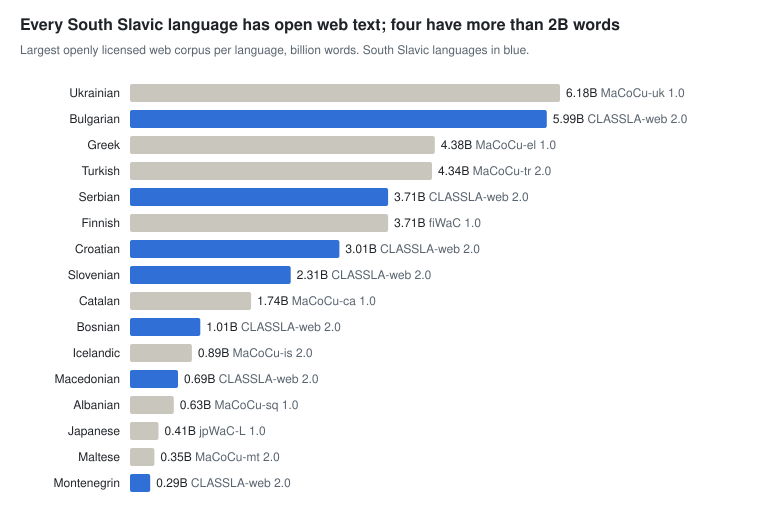

# Pre-training data

[← Overview](README.md) · Part of *CLARIN.SI resources for AI development* · Data as of 22 October 2026

The repository holds about 58B words of pre-training text once known overlaps are removed (132B words across all records), and 50B of it is openly licensed. Web corpora supply most of it: CLASSLA-web 2.0 alone has 17B words in the seven South Slavic languages, and MaCoCu adds seven more languages. For Slovenian, domain corpora add 2.6B words of scientific text, 772M words of legal text and 239M words of parliamentary debate.

South Slavic sizes from the CLASSLA-web 2.0 record; other languages from the largest single-language open web corpus.

**Sections:** [Web corpora](#web-corpora) · [Reference, news and monitor corpora](#reference-news-and-monitor-corpora) · [Books and literature](#books-and-literature) · [Specialised domains: science, law, medicine, education](#specialised-domains-science-law-medicine-education) · [Parliamentary debates](#parliamentary-debates) · [Social media and user comments](#social-media-and-user-comments) · [Historical text](#historical-text) · [Parallel and translation data](#parallel-and-translation-data)

## Web corpora

CLASSLA-web 2.0 (crawled in 2024) is the current reference for the South Slavic languages. All MaCoCu and CLASSLA-web corpora are CC0; CLASSLA-web and MaCoCu-Genre carry genre labels, and CLASSLA-web 2.0 adds topic labels. Older crawls (the WaC corpora, MaCoCu, BERTić-data) overlap with it in part.

#### Slovenian, including multilingual resources with Slovenian

| Resource | Languages | Size | Licence | Year |
| --- | --- | --- | --- | --- |
| [Genre-enriched web corpora MaCoCu-Genre](http://hdl.handle.net/11356/1969) | 13 languages | 28.5B words | CC0 | 2024 |
| [South Slavic web corpus collection CLASSLA-web 2.0](http://hdl.handle.net/11356/2079) | 7 languages | 17B words | CC0 | 2026 |
| [Slovene web corpus MaCoCu-sl 2.0](http://hdl.handle.net/11356/1795) | sl | 1.9B words | CC0 | 2023 |
| [Slovenian web corpus CLASSLA-web.sl 1.0](http://hdl.handle.net/11356/1882) | sl | 1.8B words | CC0 | 2024 |
| [Comparable corpora of South-Slavic Wikipedias CLASSLA-Wikipedia 1.0](http://hdl.handle.net/11356/1427) | 7 languages | 486.3M words | CC BY | 2021 |

#### Other languages

| Resource | Languages | Size | Licence | Year |
| --- | --- | --- | --- | --- |
| [Text collection for training the BERTić transformer model BERTić-data](http://hdl.handle.net/11356/1426) | bs, hr, cnr, sr | 8.4B words | CC BY-SA | 2021 |
| [Bulgarian web corpus MaCoCu-bg 2.0](http://hdl.handle.net/11356/1800) | bg | 3.5B words | CC0 | 2023 |
| [Bulgarian web corpus CLASSLA-web.bg 1.0](http://hdl.handle.net/11356/1928) | bg | 3.2B words | CC0 | 2024 |
| [Serbian web corpus MaCoCu-sr 1.0](http://hdl.handle.net/11356/1807) | sr | 2.5B words | CC0 | 2023 |
| [Croatian web corpus MaCoCu-hr 2.0](http://hdl.handle.net/11356/1806) | hr | 2.4B words | CC0 | 2023 |
| [Serbian web corpus CLASSLA-web.sr 1.0](http://hdl.handle.net/11356/1931) | sr | 2.3B words | CC0 | 2024 |
| [Croatian web corpus CLASSLA-web.hr 1.0](http://hdl.handle.net/11356/1929) | hr | 2.2B words | CC0 | 2024 |
| [Croatian web corpus hrWaC 2.1](http://hdl.handle.net/11356/1064) | hr | 1.4B words | CC BY-SA | 2016 |
| [Bosnian web corpus MaCoCu-bs 1.0](http://hdl.handle.net/11356/1808) | bs | 730.3M words | CC0 | 2023 |
| [Serbian Web Corpus PDRS 1.0](http://hdl.handle.net/11356/1752) | sr | 715.4M words | CC BY | 2023 |
| [Bosnian web corpus CLASSLA-web.bs 1.0](http://hdl.handle.net/11356/1927) | bs | 686.2M words | CC0 | 2024 |
| [Serbian web corpus srWaC 1.1](http://hdl.handle.net/11356/1063) | sr | 554.6M words | CC BY-SA | 2016 |
| [Macedonian web corpus MaCoCu-mk 2.0](http://hdl.handle.net/11356/1801) | mk | 524.1M words | CC0 | 2023 |
| [Macedonian web corpus CLASSLA-web.mk 1.0](http://hdl.handle.net/11356/1932) | mk | 479.1M words | CC0 | 2024 |
| [Bosnian web corpus bsWaC 1.1](http://hdl.handle.net/11356/1062) | bs | 286.9M words | CC BY-SA | 2016 |
| [Montenegrin web corpus MaCoCu-cnr 1.0](http://hdl.handle.net/11356/1809) | cnr | 161.4M words | CC0 | 2023 |
| [Montenegrin web corpus CLASSLA-web.cnr 1.0](http://hdl.handle.net/11356/1930) | cnr | 150.7M words | CC0 | 2024 |
| [Montenegrin web corpus meWaC 1.0](http://hdl.handle.net/11356/1429) | cnr | 90.9M words | CC BY-SA | 2021 |
| [Ukrainian web corpus MaCoCu-uk 1.0](http://hdl.handle.net/11356/1838) | uk | 6.2B words | CC0 | 2023 |
| [Greek web corpus MaCoCu-el 1.0](http://hdl.handle.net/11356/1839) | el | 4.4B words | CC0 | 2023 |
| [Turkish web corpus MaCoCu-tr 2.0](http://hdl.handle.net/11356/1802) | tr | 4.3B words | CC0 | 2023 |
| [Finnish web corpus fiWaC 1.0](http://hdl.handle.net/11356/1074) | fi, en | 3.7B words | CC BY-SA | 2016 |
| [Catalan web corpus MaCoCu-ca 1.0](http://hdl.handle.net/11356/1837) | ca | 1.7B words | CC0 | 2023 |
| [Icelandic web corpus MaCoCu-is 2.0](http://hdl.handle.net/11356/1805) | is | 887.2M words | CC0 | 2023 |
| [Albanian web corpus MaCoCu-sq 1.0](http://hdl.handle.net/11356/1804) | sq | 625.7M words | CC0 | 2023 |
| [Japanese web corpus with difficulty levels jpWaC-L 1.0](http://hdl.handle.net/11356/1047) | ja | 409M words | CC BY-SA | 2008 |
| [Maltese web corpus MaCoCu-mt 2.0](http://hdl.handle.net/11356/1803) | mt | 347.9M words | CC0 | 2023 |

## Reference, news and monitor corpora

The largest curated Slovenian collections (metaFida, Gigafida, Trendi) are records without files: they can be queried in the CLARIN.SI concordancers but not downloaded. The downloadable subsets and the Croatian news corpora are non-commercial.

#### Slovenian, including multilingual resources with Slovenian

| Resource | Languages | Size | Licence | Year |
| --- | --- | --- | --- | --- |
| [Corpus of combined Slovenian corpora metaFida 1.0](http://hdl.handle.net/11356/1775) | sl | 4.7B words | none, no files | 2023 |
| [Corpus of written standard Slovene Gigafida 2.2](http://hdl.handle.net/11356/2106) | sl | 1.1B words | none, no files | 2025 |
| [Monitor corpus of Slovene Trendi 2026-09](http://hdl.handle.net/11356/2572) | sl | 1.1B words | none, no files | 2026 |
| [Written corpus ccGigafida 1.0](http://hdl.handle.net/11356/1035) | sl | 103.2M words | CC BY-NC-SA | 2013 |
| [Written corpus ccKres 1.0](http://hdl.handle.net/11356/1034) | sl | 9.8M words | CC BY-NC-SA | 2013 |
| [Annotated corpus of Slovenian language-related news articles MetaLangNEWS-Sl](http://hdl.handle.net/11356/1360) | sl | 588.9k words | CC BY-NC-SA | 2020 |

#### Other languages

| Resource | Languages | Size | Licence | Year |
| --- | --- | --- | --- | --- |
| [Corpus of Croatian news portals ENGRI (2014-2018)](http://hdl.handle.net/11356/1416) | hr | 694.8M words | CC BY-NC-SA | 2021 |
| [Croatian language corpus Riznica 0.1](http://hdl.handle.net/11356/1180) | hr | 85.3M words | CC BY-NC-SA | 2018 |
| [Annotated corpus of Serbian language-related news articles MetaLangNEWS-Sr](http://hdl.handle.net/11356/1371) | sr | 659.1k words | CC BY-NC-SA | 2020 |
| [24sata news article archive 1.0](http://hdl.handle.net/11356/1410) | hr | 657.8k texts | CC BY-NC-ND | 2021 |
| [Annotated corpus of Croatian language-related news articles MetaLangNEWS-Hr](http://hdl.handle.net/11356/1369) | hr | 555.9k words | CC BY-NC-SA | 2020 |
| [Annotated corpus of Macedonian language-related news articles MetaLangNEWS-Mk](http://hdl.handle.net/11356/1652) | mk | 144.2k words | CC BY-NC-SA | 2022 |
| [Corpus of Bosnia and Herzegovina language-related news articles MetaLangNEWS-Bs](http://hdl.handle.net/11356/1690) | bs, sr, hr | 430 articles | CC BY-NC-SA | 2022 |
| [Corpus of Montenegrin language-related news articles MetaLangNEWS-Me](http://hdl.handle.net/11356/1688) | cnr, sr | 294 articles | CC BY-NC-SA | 2022 |
| [Ekspress news article archive (in Estonian and Russian) 1.0](http://hdl.handle.net/11356/1408) | et, ru | 1.4M texts | CC BY-NC-ND | 2021 |
| [Latvian Delfi article archive (in Latvian and Russian) 1.0](http://hdl.handle.net/11356/1409) | lv, ru | 180.4k texts | CC BY-NC-ND | 2021 |

## Books and literature

The 2026 e-book release adds 231 EPUB samples (the opening part of each book) from 6 Slovenian publishers under CC BY-SA. It is the only sizeable block of contemporary edited long-form prose and poetry in the repository.

| Resource | Languages | Size | Licence | Year |
| --- | --- | --- | --- | --- |
| E-book samples from Slovenian publishers (231 records, EPUB; search the repository for "Sample from the e-book") | sl | 13.5k pages | CC BY-SA | 2026 |
| [Corpus of 1968 Slovenian literature Maj68 3.0](http://hdl.handle.net/11356/1970) | sl | 1M words | CC BY-NC-SA | 2024 |
| [Corpus of daily jokes from the 24ur.com portal Šale24 1.0](http://hdl.handle.net/11356/1945) | sl | 129.1k words | CC BY-NC | 2024 |
| [Collection of Slovenian riddles Uganke 1.0](http://hdl.handle.net/11356/2023) | sl | 2.8k items | CC BY | 2025 |
| [The e-book "Soneti" (Sonnets)](http://hdl.handle.net/11356/2164) | sl | 104 pages | CC BY-SA | 2026 |
| [Collection of Slovenian paremiological units Pregovori 1.1](http://hdl.handle.net/11356/1853) | sl | – | CC BY | 2023 |

## Specialised domains: science, law, medicine, education

OSS (2.6B words, CC BY-SA) and COLESLAW (772M words, CC BY) are the two large openly licensed Slovenian domain corpora. The KAS academic corpora are larger in total but restricted to academic users.

#### Slovenian, including multilingual resources with Slovenian

| Resource | Languages | Size | Licence | Year |
| --- | --- | --- | --- | --- |
| [Corpus of scientific texts from the Open Science Slovenia portal OSS 1.0](http://hdl.handle.net/11356/1774) | sl | 2.6B words | CC BY-SA | 2023 |
| [Corpus of academic Slovene KAS 2.0](http://hdl.handle.net/11356/1448) | sl | 1.5B words | ACA (BY-NC) | 2022 |
| [Corpus of Academic Slovene (BSc/BA theses) KAS-dipl 1.0](http://hdl.handle.net/11356/1267) | sl | 1.1B words | ACA (BY-NC) | 2019 |
| [Collection of Slovenian legal texts COLESLAW 1.0](http://hdl.handle.net/11356/2095) | sl | 771.9M words | CC BY | 2024 |
| [Corpus of Academic Slovene (MSc/MA theses) KAS-mag 1.0](http://hdl.handle.net/11356/1266) | sl | 495.8M words | ACA (BY-NC) | 2019 |
| [Corpus of Academic Slovene (PhD theses) KAS-dr 1.0](http://hdl.handle.net/11356/1265) | sl | 101.5M words | ACA (BY-NC) | 2019 |
| [Corpus of scientific texts of contemporary Slovenian KZB 1.0](http://hdl.handle.net/11356/1872) | sl | 33.6M words | CC BY-SA | 2023 |
| [Tourism Corpus TURK 3.0](http://hdl.handle.net/11356/2075) | sl, it, en, de | 29.5M words | CC BY | 2025 |
| [Abstracts from the KAS corpus KAS-Abs 2.0](http://hdl.handle.net/11356/1449) | sl, en | 28.4M words | ACA (BY-NC) | 2022 |
| [Corpus of Slovene linguistic scientific writing JezKor](http://hdl.handle.net/11356/1755) | sl | 9.3M words | CC BY | 2023 |
| [Corpus of Informatics DSI 5.0](http://hdl.handle.net/11356/1239) | sl | 4.3M words | ACA (BY-NC) | 2019 |
| [Corpus of Slovenian textbooks ccUčbeniki 1.0](http://hdl.handle.net/11356/1693) | sl | 2.2M words | CC BY-NC-SA | 2022 |
| [Developmental corpus (without language corrections) Šolar 2.0 Clear](http://hdl.handle.net/11356/1219) | sl | 1.6M words | CC BY-NC-SA | 2019 |
| [Slovene learner corpus KOST 2.1](http://hdl.handle.net/11356/2066) | sl | 1.4M words | CC BY-SA | 2025 |
| [Corpus of Slovenian texts for pedagogical purposes ccMAKS 1.0](http://hdl.handle.net/11356/1692) | sl | 1.2M words | CC BY-SA | 2022 |
| [Corpus of textbooks for learning Slovenian as L2 KUUS 2.0](http://hdl.handle.net/11356/1877) | sl | 727.4k words | ACA (BY-NC) | 2023 |
| [Pilot corpus of student academic texts KOŠ 1.0](http://hdl.handle.net/11356/2048) | sl | 542.1k words | CC BY-NC-SA | 2025 |
| [Developmental corpus ccŠolar 1.0](http://hdl.handle.net/11356/1224) | sl | 468.8k words | CC BY | 2019 |
| [Corpus of Slovenian school texts SBSJ 1.0](http://hdl.handle.net/11356/1413) | sl | 96.3k words | CC BY | 2021 |
| [Corpus of textbooks for learning Slovenian as L2 ccKUUS 2.0](http://hdl.handle.net/11356/1878) | sl | 83.3k words | CC BY-NC-SA | 2023 |
| [Dataset of Slovene medical texts PoVeJMo-VeMo-Med 1.0](http://hdl.handle.net/11356/1983) | sl | 17.7k texts | CC BY | 2024 |

#### Other languages

| Resource | Languages | Size | Licence | Year |
| --- | --- | --- | --- | --- |
| [Croatian corpus of non-professional written language by typical speakers and speakers with language disorders RAPUT 1.0](http://hdl.handle.net/11356/1435) | hr | 426.2k words | CC BY-SA | 2021 |
| [Monolingual Mining Corpus - RudKorP (ELEXIS)](http://hdl.handle.net/11356/1602) | sr | 136 articles | none, no files | 2020 |
| [Corpus of Legislation texts of Republic of Serbia 1.0](http://hdl.handle.net/11356/1754) | sr | 5 files | CC BY | 2022 |
| [Corpus of Romanian Academic Genres ROGER](http://hdl.handle.net/11356/1700) | ro, en | 3.3M words | none, no files | 2022 |

## Parliamentary debates

ParlaMint covers 29 parliaments with 1.2B words of speaker-attributed transcripts under CC BY. ParlaMint-en.ana is a machine translation of all of them into English (1.4B words).

| Resource | Languages | Size | Licence | Year |
| --- | --- | --- | --- | --- |
| [Multilingual comparable corpora of parliamentary debates ParlaMint 5.0](http://hdl.handle.net/11356/2004) | 29 languages | 1.2B words | CC BY | 2025 |
| [Linguistically annotated multilingual comparable corpora of parliamentary debates ParlaMint.ana 5.0](http://hdl.handle.net/11356/2005) | 29 languages | 1.2B words | CC BY | 2025 |
| [Slovenian parliamentary corpus (1990-2022) siParl 4.0](http://hdl.handle.net/11356/1936) | sl | 239.2M words | CC BY | 2024 |
| [Parliamentary corpus of first Yugoslavia (1919-1939) yu1Parl 1.0](http://hdl.handle.net/11356/1845) | sr, hr, sl | 13.3M words | CC BY | 2023 |
| [Carniolan Provincial Assembly corpus Kranjska 1.0](http://hdl.handle.net/11356/1824) | sl, de | 10.9M words | CC BY | 2023 |
| [Slovenian parliamentary corpus (1990-1992) SlovParl 2.0](http://hdl.handle.net/11356/1167) | sl | 10.8M words | CC BY | 2017 |
| [Corpus of political party programs Programi2022](http://hdl.handle.net/11356/1734) | sl | 330.6k words | CC BY-NC-SA | 2022 |
| [Comparable corpus of parliamentary debates ParlaMint-IL 1.0](http://hdl.handle.net/11356/2032) | heb | 409.4M words | CC BY-SA | 2025 |
| [Ukrainian parliamentary corpus ParlaMint-UA 4.0.1](http://hdl.handle.net/11356/1900) | uk, ru | 42M words | CC BY | 2023 |
| [Comparable corpus of parliamentary debates ParlaMint-ES-CN 1.0](http://hdl.handle.net/11356/2063) | es | 39.8M words | CC BY | 2025 |
| [Linguistically annotated multilingual comparable corpora of parliamentary debates in English ParlaMint-en.ana 5.0](http://hdl.handle.net/11356/2006) | en | 1.4B words | CC BY | 2025 |

## Social media and user comments

The Janes corpora (2017) remain the main source of Slovenian non-standard written language. The large news-comment collections for Croatian, Estonian and Latvian are no-derivatives licensed, which rules out most training uses.

#### Slovenian, including multilingual resources with Slovenian

| Resource | Languages | Size | Licence | Year |
| --- | --- | --- | --- | --- |
| [Dataset and baseline model of moderated content FRENK-MMC-RTV 1.0](http://hdl.handle.net/11356/1201) | sl | 325.2M words | CC BY-SA | 2018 |
| [Twitter corpus Janes-Tweet 1.0](http://hdl.handle.net/11356/1142) | sl | 139.3M words | CC BY-NC | 2017 |
| [Forum corpus Janes-Forum 1.0](http://hdl.handle.net/11356/1139) | sl | 47.1M words | CC BY | 2017 |
| [Blog post and comment corpus Janes-Blog 1.0](http://hdl.handle.net/11356/1138) | sl | 34.5M words | CC BY | 2017 |
| [News comment corpus Janes-News 1.0](http://hdl.handle.net/11356/1140) | sl | 14.8M words | CC BY | 2017 |
| [Slovenian Twitter dataset 2018-2020 1.0](http://hdl.handle.net/11356/1423) | sl | 13M texts | CC BY-SA | 2021 |
| [Wikipedia talk corpus Janes-Wiki 1.0](http://hdl.handle.net/11356/1137) | sl | 5M words | CC BY-SA | 2017 |
| [Annotated corpus of Slovenian language-related news comments MetaLangNEWS-COMMENTS-Sl](http://hdl.handle.net/11356/1362) | sl | 44.2k words | CC BY-NC-SA | 2020 |
| [Facebook metadata dataset LiLaH-HAG](http://hdl.handle.net/11356/1483) | en, nl, sl, hr | 10.4k entries | CC BY-NC-SA | 2022 |

#### Other languages

| Resource | Languages | Size | Licence | Year |
| --- | --- | --- | --- | --- |
| [Dataset and baseline model of moderated content FRENK-STYRIA-24sata 1.0](http://hdl.handle.net/11356/1202) | hr | 407.5M words | CC BY-SA | 2018 |
| [24sata news comment dataset 1.0](http://hdl.handle.net/11356/1399) | hr | 21.5M texts | CC BY-NC-ND | 2021 |
| [Annotated corpus of Serbian language-related news comments MetaLangNEWS-COMMENTS-Sr](http://hdl.handle.net/11356/1372) | sr | 878.5k words | CC BY-NC-SA | 2020 |
| [Annotated corpus of Croatian language-related news comments MetaLangNEWS-COMMENTS-Hr](http://hdl.handle.net/11356/1370) | hr | 823.5k words | CC BY-NC-SA | 2020 |
| [The Sarajevo Corpus of SMS Messages in Bosnian 1.1](http://hdl.handle.net/11356/1956) | bs | 105.9k words | CC BY | 2024 |
| [Corpus of Bosnia and Herzegovina language-related news comments MetaLangNEWS-COMMENTS-Bs](http://hdl.handle.net/11356/1691) | bs, sr, hr | 5.7k texts | CC BY-NC-SA | 2022 |
| [Corpus of Montenegrin language-related news comments MetaLangNEWS-COMMENTS-Me](http://hdl.handle.net/11356/1689) | cnr, sr | 2.3k texts | CC BY-NC-SA | 2022 |
| [Ekspress user comment dataset 1.0](http://hdl.handle.net/11356/1401) | et, ru | 31.5M texts | CC BY-NC-ND | 2021 |
| [Latvian user comment dataset 1.0](http://hdl.handle.net/11356/1407) | lv, ru | 12.4M texts | CC BY-NC-ND | 2021 |
| [Tweets about impact investing](http://hdl.handle.net/11356/1188) | en | 668.5k entries | CC BY-SA | 2018 |

## Historical text

sPeriodika (708M words of Slovenian periodicals, 1771–1914, CC BY-SA) is the largest historical source. It contains OCR noise; a matching post-OCR correction set is listed under post-training.

| Resource | Languages | Size | Licence | Year |
| --- | --- | --- | --- | --- |
| [Corpus of Slovenian periodicals (1771-1914) sPeriodika 1.0](http://hdl.handle.net/11356/1881) | sl | 708.3M words | CC BY-SA | 2023 |
| [Digital library and corpus of historical Slovene IMP 1.1](http://hdl.handle.net/11356/1031) | sl | 17.7M words | CC BY-SA | 2014 |
| [Corpus of longer narrative Slovenian prose KDSP 1.0](http://hdl.handle.net/11356/1823) | sl | 11.5M words | CC BY | 2023 |
| [The corpus of older Slovenian narrative prose PriLit 1.0](http://hdl.handle.net/11356/1319) | sl | 1.3M words | CC BY | 2021 |
| [Corpus of Slovenian historical legal texts SI-IUS 1.0](http://hdl.handle.net/11356/2026) | sl | 666.3k words | CC BY | 2025 |
| [Corpus of "Attacks on the Yugoslav National Army" (1989) VAYNA 1.1](http://hdl.handle.net/11356/1237) | sl | 300.7k words | CC BY | 2019 |
| [Reference corpus of historical Slovene goo300k 1.2](http://hdl.handle.net/11356/1025) | sl | 293.9k words | CC BY | 2015 |
| [Corpus of texts by Hijacint Repič in "Cvetje z vertov sv. Frančiška" CVET 1.0](http://hdl.handle.net/11356/1226) | sl | 175k words | CC BY | 2024 |
| [Concordances of Primož Trubar's "Ta evangeli sv. Matevža" (1555)](http://hdl.handle.net/11356/1124) | sl | 23.6k items | CC BY | 2018 |
| [Concordance of Trubar's Gospel of St. Matthew (1555) (ELEXIS)](http://hdl.handle.net/11356/1617) | sl | 23.6k items | none, no files | 2020 |
| [Documents on Magdalena Gornik in mid-19th century manuscripts 1.0](http://hdl.handle.net/11356/1993) | sl | 285 pages | CC BY-SA | 2024 |
| [Slovenian manuscript sermons by Ignacij Holzapfel 1.0](http://hdl.handle.net/11356/1995) | sl, de, la | 220 pages | CC BY-SA | 2024 |
| [Epigraphic corpus of Medieval and Early Modern inscriptions in Slovenia MEMIS 1.0](http://hdl.handle.net/11356/1376) | sl, la | 51 texts | CC BY-SA | 2020 |
| [Annotated Corpus of Pre-Standardized Balkan Slavic Literature 1.1](http://hdl.handle.net/11356/1441) | bg, mk | 53.3k words | CC BY-SA | 2021 |
| [Disasters corpus in classical Arabic sources DiCCAS](http://hdl.handle.net/11356/2097) | ar | 289.5k words | CC BY-NC-SA | 2026 |

## Parallel and translation data

MaCoCu provides CC0 English-paired corpora for 14 languages, from 10.6M (Icelandic) to 239M words (Ukrainian). DGT-UD adds 2.1B words of EU translation memories in 23 languages.

#### Slovenian, including multilingual resources with Slovenian

| Resource | Languages | Size | Licence | Year |
| --- | --- | --- | --- | --- |
| [JRC EU DGT Translation Memory Parsebank DGT-UD 1.0](http://hdl.handle.net/11356/1197) | 23 languages | 2.1B words | CC BY | 2018 |
| [Slovene-English parallel corpus MaCoCu-sl-en 2.0](http://hdl.handle.net/11356/1813) | sl, en | 85M words | CC0 | 2023 |
| [Slovene-English parallel corpus slenWaC 1.0](http://hdl.handle.net/11356/1061) | sl, en | 27.9M words | CLARIN.SI web-corpus licence | 2016 |
| [Machine Translation datasets from the KAS corpus KAS-MT 1.0](http://hdl.handle.net/11356/1447) | sl, en | 21.9M words | ACA (BY-NC) | 2022 |
| [Parallel sense-annotated corpus ELEXIS-WSD 2.0](http://hdl.handle.net/11356/2101) | 18 languages | 572.6k words | CC BY-SA | 2026 |
| [Slovenian translation corpus Spook 1.1](http://hdl.handle.net/11356/2077) | 5 languages | 375.5k words | ACA (BY-NC) | 2026 |
| [MULTEXT-East "1984" document corpus 4.0](http://hdl.handle.net/11356/1044) | 10 languages | 66.5k sentences | CC BY-NC-SA | 2010 |
| [Parallel corpus of idiomatic text ParaDiom 1.0](http://hdl.handle.net/11356/1714) | sl, en | 66.4k words | CC BY-NC-SA | 2022 |
| [Parallel corpus EN-SL RSDO4 2.0](http://hdl.handle.net/11356/1698) | en, sl | – | CC BY-SA | 2021 |

#### Other languages

| Resource | Languages | Size | Licence | Year |
| --- | --- | --- | --- | --- |
| [Croatian-English parallel corpus MaCoCu-hr-en 2.0](http://hdl.handle.net/11356/1814) | hr, en | 99.5M words | CC0 | 2023 |
| [Serbian-English parallel corpus MaCoCu-sr-en 1.0](http://hdl.handle.net/11356/1819) | sr, en | 95.9M words | CC0 | 2023 |
| [Bulgarian-English parallel corpus MaCoCu-bg-en 2.0](http://hdl.handle.net/11356/1815) | bg, en | 72.1M words | CC0 | 2023 |
| [Croatian-English parallel corpus hrenWaC 2.0](http://hdl.handle.net/11356/1058) | hr, en | 55.1M words | CLARIN.SI web-corpus licence | 2016 |
| [Serbian-English parallel corpus srenWaC 1.0](http://hdl.handle.net/11356/1059) | sr, en | 23.1M words | CLARIN.SI web-corpus licence | 2016 |
| [Bosnian-English parallel corpus MaCoCu-bs-en 1.0](http://hdl.handle.net/11356/1820) | bs, en | 22.2M words | CC0 | 2023 |
| [Macedonian-English parallel corpus MaCoCu-mk-en 2.0](http://hdl.handle.net/11356/1817) | mk, en | 18.3M words | CC0 | 2023 |
| [Montenegrin-English parallel corpus MaCoCu-cnr-en 1.0](http://hdl.handle.net/11356/1821) | cnr, en | 11.2M words | CC0 | 2023 |
| [English-Montenegrin parallel corpus of subtitles Opus-MontenegrinSubs 1.0](http://hdl.handle.net/11356/1176) | cnr, en | 853.2k words | CC BY-SA | 2018 |
| [Tourism English-Croatian Parallel Corpus 2.0](http://hdl.handle.net/11356/1049) | en, hr | 139.9k entries | CLARIN.SI web-corpus licence | 2016 |
| [Bilingual Corpus of Underground Mining (ELEXIS)](http://hdl.handle.net/11356/1603) | en, sr | – | none, no files | 2020 |
| [DSI-enriched ParaCrawl 9 en-es corpus](http://hdl.handle.net/11356/1526) | es, en | 269.4M sentences | CC0 | 2022 |
| [Ukrainian-English parallel corpus MaCoCu-uk-en 1.0](http://hdl.handle.net/11356/1858) | uk, en | 238.8M words | CC0 | 2023 |
| [Greek-English parallel corpus MaCoCu-el-en 1.0](http://hdl.handle.net/11356/1856) | el, en | 151.1M words | CC0 | 2023 |
| [Catalan-English parallel corpus MaCoCu-ca-en 1.0](http://hdl.handle.net/11356/1857) | ca, en | 142.9M words | CC0 | 2023 |
| [Turkish-English parallel corpus MaCoCu-tr-en 2.0](http://hdl.handle.net/11356/1816) | tr, en | 89.2M words | CC0 | 2023 |
| [DSI-enriched ParaCrawl 9 en-nl corpus](http://hdl.handle.net/11356/1527) | en, nl | 89.1M sentences | CC0 | 2022 |
| [Finnish-English parallel corpus fienWaC 1.0](http://hdl.handle.net/11356/1060) | fi, en | 77M words | CLARIN.SI web-corpus licence | 2016 |
| [Maltese-English parallel corpus MaCoCu-mt-en 2.0](http://hdl.handle.net/11356/1811) | mt, en | 53.9M words | CC0 | 2023 |
| [Albanian-English parallel corpus MaCoCu-sq-en 1.0](http://hdl.handle.net/11356/1818) | sq, en | 24.3M words | CC0 | 2023 |
| [Icelandic-English parallel corpus MaCoCu-is-en 2.0](http://hdl.handle.net/11356/1812) | is, en | 10.6M words | CC0 | 2023 |
| [Parallel Corpus (EN-LT) of EUR-Lex Documents That Include Terms with the Adjective 'Green' (ELEXIS)](http://hdl.handle.net/11356/1628) | en, lt | 8.1M words | none, no files | 2021 |
| [Parallel Corpus (EN-FR-LT) of EU Financial Documents (ELEXIS)](http://hdl.handle.net/11356/1636) | en, lt, fr | 3M words | none, no files | 2021 |
| [Parallel Corpus (EN-LT-DA) of General Data Protection Regulation (ELEXIS)](http://hdl.handle.net/11356/1632) | en, lt, da | 144.8k words | none, no files | 2021 |
| [TED-ELH Parallel Corpus (ELEXIS)](http://hdl.handle.net/11356/1635) | en, lt, heb | 87.1k sentences | none, no files | 2021 |
| [Parallel Corpus (EN-LT-FR) of EUR-Lex Document Extracts That Include Terms with the Colour Names Black, White and Grey](http://hdl.handle.net/11356/1630) | en, lt, fr | 69.7k words | none, no files | 2021 |

---

Other stages: [Pre-training data](01-pretraining.md) · [Speech and multimodal data](02-speech-multimodal.md) · [Post-training data](03-post-training.md) · [Evaluation and benchmarks](04-evaluation.md) · [Lexical and knowledge resources](05-lexical-knowledge.md) · [Models and tools](06-models-tools.md)
