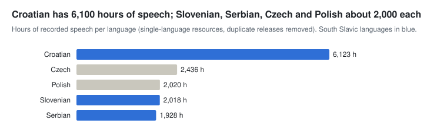

# Speech and multimodal data

[← Overview](./) · Part of *CLARIN.SI resources for AI development* · Data as of 22 October 2026

The repository holds about 14,500 hours of recorded speech. ParlaSpeech gives about 12,400 hours of aligned parliamentary speech for Croatian, Czech, Polish and Serbian. Slovenian has about 2,000 hours from ARTUR (1,067 h, built for ASR), Gos 2.1 (319 h, academic users only), 304 h of audiobook samples and the 100-hour Gail Valley dialect corpus. Multimodal data is limited to two recent Slovenian sets.

Sum of hours in local.size.info; ARTUR transcriptions, ParlaSpeech 3.0 and GORDAN transcriptions excluded as duplicates.

**Sections:** [Speech recordings](#speech-recordings) · [Spoken-language transcripts](#spoken-language-transcripts) · [Multimodal data](#multimodal-data)

## Speech recordings

ParlaSpeech 3.0 adds pause, stress, syntax and sentiment layers to the ParlaSpeech recordings without re-releasing the audio.

#### Slovenian, including multilingual resources with Slovenian

| Resource | Languages | Size | Licence | Year |
| --- | --- | --- | --- | --- |
| Audiobook samples from Slovenian publishers (171 records, MP3; search the repository for "Sample from the audiobook") | sl | 304 h | CC BY-SA | 2026 |
| [ASR database ARTUR 1.0 (audio)](http://hdl.handle.net/11356/1776) | sl | 1,067 h | CC BY-SA | 2023 |
| [ASR database ARTUR 1.0 (transcriptions)](http://hdl.handle.net/11356/1772) | sl | 884 h | CC BY-SA | 2023 |
| [Spoken corpus Gos 2.1 (audio, video)](http://hdl.handle.net/11356/1973) | sl | 319 h | ACA (BY) | 2024 |
| [Spoken corpus Gos 1.1](http://hdl.handle.net/11356/1438) | sl | 1M words | CC BY-NC-SA | 2021 |
| [Corpus of the Gail Valley dialect Zila 1.0](http://hdl.handle.net/11356/2257) | sl | 100 h | CC BY-NC-SA | 2026 |
| [Phonetic segmentation and acoustic measurements of spoken Slovenian SloPhonSeg 1.0](http://hdl.handle.net/11356/2209) | sl | 395.3k words | CC BY-SA | 2026 |
| [Spoken corpus Gos VideoLectures 4.0 (audio)](http://hdl.handle.net/11356/1222) | sl | 22 h | CC BY-NC-ND | 2019 |
| [The "Mobile languages" corpus MoJezik 1.0 (audio)](http://hdl.handle.net/11356/2042) | sl | 10 h | ACA (BY) | 2025 |
| [Speech Database of Spoken Flight Information Enquiries SOFES 1.0](http://hdl.handle.net/11356/1125) | sl | 10 h | CC BY-NC-SA | 2017 |
| [Spoken corpus Berta](http://hdl.handle.net/11356/1977) | sl | 6 h | CC BY-SA | 2024 |
| [Corpus of spoken Slovenian ROG-Dialog 1.0](http://hdl.handle.net/11356/2073) | sl | 50.5k words | CC BY-SA | 2025 |
| [Corpus of conversational humor Krohot 1.0](http://hdl.handle.net/11356/2065) | sl | 4 h | CC BY-NC-ND | 2025 |
| [Dataset for primary stress identification in Croatian and related languages and dialects](http://hdl.handle.net/11356/2038) | hr, sl, sr, ckm | 12.8k words | CC BY-SA | 2025 |
| [Dialogue act annotated spoken corpus GORDAN 1.0 (transcription)](http://hdl.handle.net/11356/1291) | sl | 1 h | CC BY | 2020 |
| [Dialogue act annotated spoken corpus GORDAN 1.0 (audio/video)](http://hdl.handle.net/11356/1292) | sl | 1 h | CC BY-NC-SA | 2020 |
| [Multimodal corpus EVA 1.0](http://hdl.handle.net/11356/1311) | sl | 57 min | CC BY-SA | 2020 |

#### Other languages

| Resource | Languages | Size | Licence | Year |
| --- | --- | --- | --- | --- |
| [Parliamentary spoken corpus of Croatian ParlaSpeech-HR 2.0](http://hdl.handle.net/11356/1914) | hr | 6,122 h | CC BY-SA | 2024 |
| [Parliamentary spoken corpus of Serbian ParlaSpeech-RS 1.0](http://hdl.handle.net/11356/1834) | sr | 1,792 h | CC BY-SA | 2024 |
| [Spoken Torlak dialect corpus 1.0 (transcription)](http://hdl.handle.net/11356/1281) | sr | 498k words | CC BY-NC | 2020 |
| [ASR training dataset for Serbian JuzneVesti-SR v1.0](http://hdl.handle.net/11356/1679) | sr | 51 h | CC BY-SA | 2022 |
| [Spoken corpora of parliamentary debates ParlaSpeech 3.0](http://hdl.handle.net/11356/1833) | hr, sr, pl, cs | 48.4M words | CC BY-SA | 2025 |
| [Parliamentary spoken corpus of Czech ParlaSpeech-CZ 1.0](http://hdl.handle.net/11356/1785) | cs | 2,436 h | CC BY-SA | 2024 |
| [Parliamentary spoken corpus of Polish ParlaSpeech-PL 1.0](http://hdl.handle.net/11356/1686) | pl | 2,020 h | CC BY-SA | 2024 |
| [The "Mići Princ" text and speech dataset of Chakavian micro-dialects](http://hdl.handle.net/11356/1765) | hr, ckm | 11.6k words | CC BY-SA | 2024 |
| [Business English learner speech corpus SAPS](http://hdl.handle.net/11356/1436) | en | 55.4k words | CC BY-NC | 2021 |

## Spoken-language transcripts

These corpora have no audio in the repository, or only small amounts; their main value is as spoken-language text.

| Resource | Languages | Size | Licence | Year |
| --- | --- | --- | --- | --- |
| [Spoken corpus Gos 2.1 (transcriptions)](http://hdl.handle.net/11356/1863) | sl | 2.5M words | CC BY-SA | 2023 |
| [Spoken corpus Gos VideoLectures 4.2 (transcription)](http://hdl.handle.net/11356/1444) | sl | 170.8k words | CC BY | 2021 |
| [The "Mobile languages" corpus MoJezik 1.0 (transcription)](http://hdl.handle.net/11356/2037) | sl | 78.9k words | CC BY | 2025 |
| [Corpus of metaphorical expressions in spoken Slovene language G-KOMET 1.0](http://hdl.handle.net/11356/1490) | sl | 52.5k words | CC BY-NC-SA | 2022 |
| [SNABI database for continuous speech recognition 1.2](http://hdl.handle.net/11356/1051) | sl | 15k items | CC BY-NC-SA | 2002 |
| [Corpus of Serbian Forms of Address 1.1](http://hdl.handle.net/11356/1779) | sr | 171.5k words | CC BY-NC-SA | 2023 |
| [Map task corpus of heritage BCMS 1.0](http://hdl.handle.net/11356/1750) | sr, hr, bs, hbs | 13k words | CC BY-NC-SA | 2023 |
| [Heritage Bosnian, Croatian, and Serbian spoken by Second Generation Speakers in Germany He-BCS-Ge](http://hdl.handle.net/11356/1979) | bs, hr, sr | 15 texts | CC BY-NC | 2024 |
| [Albanian Spoken Corpus in Kosovo 1.0](http://hdl.handle.net/11356/1955) | sq, aln | 160.2k words | CC BY | 2024 |

## Multimodal data

The vision-language instruction set SLO-VLM-IT (1.1M items) is listed under post-training.

| Resource | Languages | Size | Licence | Year |
| --- | --- | --- | --- | --- |
| [Multimodal document understanding dataset from "Ilustrirani Slovenec"](http://hdl.handle.net/11356/2317) | sl | 39.8k texts | CC BY-NC | 2026 |

---

Other stages: [Pre-training data](01-pretraining.md) · [Speech and multimodal data](02-speech-multimodal.md) · [Post-training data](03-post-training.md) · [Evaluation and benchmarks](04-evaluation.md) · [Lexical and knowledge resources](05-lexical-knowledge.md) · [Models and tools](06-models-tools.md)
