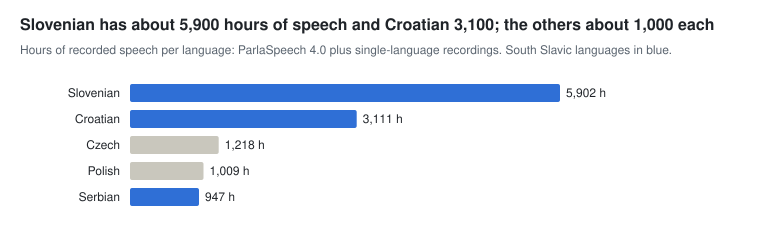

# Speech and multimodal data

[← Overview](./) · Part of *CLARIN.SI resources for AI development* · Data as of 22 October 2026

The repository holds about 12,200 hours of recorded speech. ParlaSpeech 4.0, whose release is pending, gives 10,313 hours of aligned parliamentary speech: Slovenian 4,080 h, Croatian 3,110 h, Czech 1,218 h, Polish 1,009 h and Serbian 896 h. Beyond parliament, Slovenian adds ARTUR (1,067 h, built for ASR), Gos 2.1 (319 h, academic users only), 304 h of audiobook samples and the 100-hour Gail Valley dialect corpus, for about 5,900 hours in total. Multimodal data is limited to two recent Slovenian sets.

Each record's stated duration counted once; transcript-only releases and resources derived from other recordings left out.

**Sections:** [Speech recordings](#speech-recordings) · [Spoken-language transcripts](#spoken-language-transcripts) · [Multimodal data](#multimodal-data)

## Speech recordings

ParlaSpeech 4.0 (release pending) supersedes all earlier ParlaSpeech releases, which were subsets of it, and is listed here once per language. Each language comes as sentence-aligned transcripts with filled and silent pauses (and word stress for Croatian and Serbian), with the FLAC audio in a separate record.

#### Slovenian, including multilingual resources with Slovenian

| Resource | Languages | Size | Licence | Year |
| --- | --- | --- | --- | --- |
| ParlaSpeech 4.0 · Slovenian: [transcriptions](http://hdl.handle.net/11356/1885), [audio](http://hdl.handle.net/11356/1889) | sl | 4,080 h | CC BY-SA | 2026 |
| [ASR database ARTUR 1.0 (audio)](http://hdl.handle.net/11356/1776) | sl | 1,067 h | CC BY-SA | 2023 |
| [Spoken corpus Gos 2.1 (audio, video)](http://hdl.handle.net/11356/1973) | sl | 319 h | ACA (BY) | 2024 |
| Audiobook samples from Slovenian publishers (171 records, MP3; search the repository for "Sample from the audiobook") | sl | 304 h | CC BY-SA | 2026 |
| [Corpus of the Gail Valley dialect Zila 1.0](http://hdl.handle.net/11356/2257) | sl | 100 h | CC BY-NC-SA | 2026 |
| [Phonetic segmentation and acoustic measurements of spoken Slovenian SloPhonSeg 1.0](http://hdl.handle.net/11356/2209) | sl | 395.3k words | CC BY-SA | 2026 |
| [The "Mobile languages" corpus MoJezik 1.0 (audio)](http://hdl.handle.net/11356/2042) | sl | 10 h | ACA (BY) | 2025 |
| [Speech Database of Spoken Flight Information Enquiries SOFES 1.0](http://hdl.handle.net/11356/1125) | sl | 10 h | CC BY-NC-SA | 2017 |
| [Spoken corpus Berta](http://hdl.handle.net/11356/1977) | sl | 6 h | CC BY-SA | 2024 |
| [Corpus of spoken Slovenian ROG-Dialog 1.0](http://hdl.handle.net/11356/2073) | sl | 50.5k words | CC BY-SA | 2025 |
| [Corpus of conversational humor Krohot 1.0](http://hdl.handle.net/11356/2065) | sl | 4 h | CC BY-NC-ND | 2025 |
| [Dataset for primary stress identification in Croatian and related languages and dialects](http://hdl.handle.net/11356/2038) | hr, sl, sr, ckm | 12.8k words | CC BY-SA | 2025 |
| [Dialogue act annotated spoken corpus GORDAN 1.0 (audio/video)](http://hdl.handle.net/11356/1292) | sl | 1 h | CC BY-NC-SA | 2020 |
| [Multimodal corpus EVA 1.0](http://hdl.handle.net/11356/1311) | sl | 57 min | CC BY-SA | 2020 |

#### Other languages

| Resource | Languages | Size | Licence | Year |
| --- | --- | --- | --- | --- |
| ParlaSpeech 4.0 · Croatian: [transcriptions](http://hdl.handle.net/11356/1885), [audio](http://hdl.handle.net/11356/1889) | hr | 3,110 h | CC BY-SA | 2026 |
| ParlaSpeech 4.0 · Czech: [transcriptions](http://hdl.handle.net/11356/1885), [audio](http://hdl.handle.net/11356/1889) | cs | 1,218 h | CC BY-SA | 2026 |
| ParlaSpeech 4.0 · Polish: [transcriptions](http://hdl.handle.net/11356/1885), [audio](http://hdl.handle.net/11356/1889) | pl | 1,009 h | CC BY-SA | 2026 |
| ParlaSpeech 4.0 · Serbian: [transcriptions](http://hdl.handle.net/11356/1885), [audio](http://hdl.handle.net/11356/1889) | sr | 896 h | CC BY-SA | 2026 |
| [ASR training dataset for Serbian JuzneVesti-SR v1.0](http://hdl.handle.net/11356/1679) | sr | 51 h | CC BY-SA | 2022 |
| [The "Mići Princ" text and speech dataset of Chakavian micro-dialects](http://hdl.handle.net/11356/1765) | hr, ckm | 11.6k words | CC BY-SA | 2024 |
| [Business English learner speech corpus SAPS](http://hdl.handle.net/11356/1436) | en | 55.4k words | CC BY-NC | 2021 |

## Spoken-language transcripts

These corpora have no audio in the repository, or only small amounts; their main value is as spoken-language text.

| Resource | Languages | Size | Licence | Year |
| --- | --- | --- | --- | --- |
| [ASR database ARTUR 1.0 (transcriptions)](http://hdl.handle.net/11356/1772) | sl | 884 h | CC BY-SA | 2023 |
| [Spoken corpus Gos 2.1 (transcriptions)](http://hdl.handle.net/11356/1863) | sl | 2.5M words | CC BY-SA | 2023 |
| [Dialogue act annotated spoken corpus GORDAN 1.0 (transcription)](http://hdl.handle.net/11356/1291) | sl | 1 h | CC BY | 2020 |
| [The "Mobile languages" corpus MoJezik 1.0 (transcription)](http://hdl.handle.net/11356/2037) | sl | 78.9k words | CC BY | 2025 |
| [Corpus of metaphorical expressions in spoken Slovene language G-KOMET 1.0](http://hdl.handle.net/11356/1490) | sl | 52.5k words | CC BY-NC-SA | 2022 |
| [SNABI database for continuous speech recognition 1.2](http://hdl.handle.net/11356/1051) | sl | 15k items | CC BY-NC-SA | 2002 |
| [Spoken Torlak dialect corpus 1.0 (transcription)](http://hdl.handle.net/11356/1281) | sr | 498k words | CC BY-NC | 2020 |
| [Corpus of Serbian Forms of Address 1.1](http://hdl.handle.net/11356/1779) | sr | 171.5k words | CC BY-NC-SA | 2023 |
| [Map task corpus of heritage BCMS 1.0](http://hdl.handle.net/11356/1750) | sr, hr, bs, hbs | 13k words | CC BY-NC-SA | 2023 |
| [Heritage Bosnian, Croatian, and Serbian spoken by Second Generation Speakers in Germany He-BCS-Ge](http://hdl.handle.net/11356/1979) | bs, hr, sr | 15 texts | CC BY-NC | 2024 |
| [Albanian Spoken Corpus in Kosovo 1.0](http://hdl.handle.net/11356/1955) | sq, aln | 160.2k words | CC BY | 2024 |

## Multimodal data

The vision-language instruction set SLO-VLM-IT (1.1M items) is listed under post-training.

| Resource | Languages | Size | Licence | Year |
| --- | --- | --- | --- | --- |
| [Multimodal document understanding dataset from "Ilustrirani Slovenec"](http://hdl.handle.net/11356/2317) | sl | 39.8k texts | CC BY-NC | 2026 |

---

Other stages: [Pre-training data](01-pretraining.md) · [Speech and multimodal data](02-speech-multimodal.md) · [Post-training data](03-post-training.md) · [Evaluation and benchmarks](04-evaluation.md) · [Lexical and knowledge resources](05-lexical-knowledge.md) · [Models and tools](06-models-tools.md)
