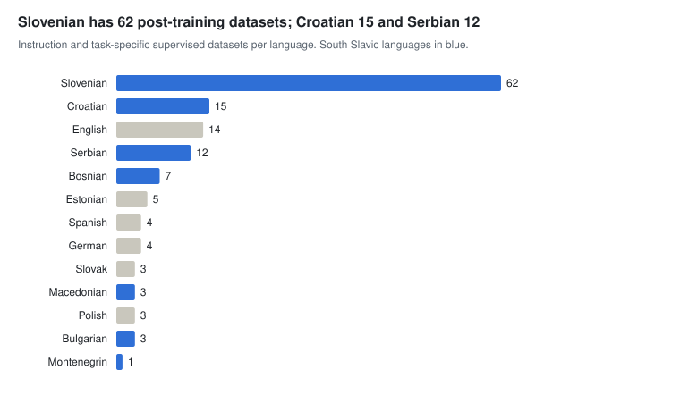

# Post-training data

[← Overview](README.md) · Part of *CLARIN.SI resources for AI development* · Data as of 22 October 2026

All instruction data in the repository is Slovenian: the GaMS-Instruct family and SloLexQA hold about 2.2M prompt–response pairs, 2.17M of them from three 2026 medical and pharmaceutical sets built from databases with LLM enrichment. General-purpose, human-written instruction data is limited to GaMS-Instruct-DH (10k pairs). There is no preference or chat-format data. The 72 task-specific supervised sets cover more languages and can be converted into instruction format.

Datasets with files; a multilingual dataset counts once for each of its languages.

**Sections:** [Instruction, QA and alignment data](#instruction-qa-and-alignment-data) · [Text-to-text: correction, normalisation, simplification, summarisation](#text-to-text-correction-normalisation-simplification-summarisation) · [Linguistic annotation: tagging, parsing, NER, coreference, multiword units](#linguistic-annotation-tagging-parsing-ner-coreference-multiword-units) · [Semantics, knowledge and information extraction](#semantics-knowledge-and-information-extraction) · [Text classification: sentiment, hate speech, genre, topic, stance, language ID](#text-classification-sentiment-hate-speech-genre-topic-stance-language-id)

## Instruction, QA and alignment data

Three expert Q&A archives (ŠUSS, TermSvet, Terminologišče) contain real questions answered by linguists and terminologists. They are not yet in instruction format but are natural candidates for supervised fine-tuning.

| Resource | Languages | Size | Licence | Year |
| --- | --- | --- | --- | --- |
| [Slovenian Dataset for Vision-Language Model Instruction-Tuning SLO-VLM-IT-Dataset 1.0](http://hdl.handle.net/11356/2050) | sl | 1.1M texts | CC BY-NC | 2025 |
| [Slovene instruction-following dataset for large language models GaMS-Instruct-MED-Termset 1.0](http://hdl.handle.net/11356/2089) | sl | 975.1k units | CC BY | 2026 |
| [Slovene instruction-following dataset for large language models GaMS-Instruct-MED-Anatomy 1.0](http://hdl.handle.net/11356/2085) | sl | 711.8k units | CC BY | 2026 |
| [Slovene instruction-following dataset for large language models GaMS-Instruct-PHARMA 1.0](http://hdl.handle.net/11356/2081) | sl | 482.3k units | CC BY | 2026 |
| [ŠUSS archive of questions and answers about the Slovenian language (1998-2010)](http://hdl.handle.net/11356/1242) | sl | 365.4k words | CC BY | 2019 |
| [Corpus of the ZRC SAZU Terminology Consulting Service TermSvet 1.0](http://hdl.handle.net/11356/2262) | sl | 282.2k words | CC BY | 2026 |
| [Slovene instruction-following dataset for large language models GaMS-Instruct-MED 2.0](http://hdl.handle.net/11356/2045) | sl | 25k units | CC BY | 2025 |
| [Slovene Lexicographic QA Fine-Tuning Corpus SloLexQA 1.0](http://hdl.handle.net/11356/2116) | sl | 16.5k items | CC BY | 2026 |
| [Slovene instruction-following dataset for large language models GaMS-Instruct-DH 1.0](http://hdl.handle.net/11356/1975) | sl | 10.2k units | CC BY-SA | 2024 |
| [Slovene instruction-following dataset for large language models GaMS-Instruct-GEN 1.0](http://hdl.handle.net/11356/1971) | sl | 6.8k units | CC BY | 2024 |
| [Corpus of questions and answers of the Terminologišče terminological counselling service](http://hdl.handle.net/11356/1741) | sl | 509 texts | CC BY | 2022 |
| [Slovene instruction-following safety dataset for large language models GaMS-Instruct-SAFE 0.5](http://hdl.handle.net/11356/2218) | sl | 501 units | CC BY-SA | 2026 |

## Text-to-text: correction, normalisation, simplification, summarisation

| Resource | Languages | Size | Licence | Year |
| --- | --- | --- | --- | --- |
| [Summarization datasets from the KAS corpus KAS-Sum 1.0](http://hdl.handle.net/11356/1446) | sl, en | 1.1B words | ACA (BY-NC) | 2022 |
| [Developmental corpus Šolar 3.0](http://hdl.handle.net/11356/1589) | sl | 1.6M words | CC BY-NC-SA | 2022 |
| [Error-annotated developmental corpus Šolar 2.0 Error](http://hdl.handle.net/11356/1231) | sl | 756.1k words | CC BY-NC-SA | 2019 |
| [Dataset of normalised Slovene text KonvNormSl 1.0](http://hdl.handle.net/11356/1068) | sl | 427k words | CC BY-SA | 2016 |
| [CMC training corpus Janes-Norm 3.0](http://hdl.handle.net/11356/1733) | sl | 283.3k words | CC BY-SA | 2022 |
| [Corpus of comma placement Vejica 1.3](http://hdl.handle.net/11356/1185) | sl | 104.2k sentences | CC BY-NC-SA | 2018 |
| [Post-edited and error annotated machine translation corpus PErr 1.0](http://hdl.handle.net/11356/1065) | 5 languages | 43.9k words | CC BY-SA | 2016 |
| [CMC shortening corpus Janes-Kratko 1.0](http://hdl.handle.net/11356/1087) | sl | 20.2k words | CC BY-SA | 2017 |
| [Tweet comma corpus Janes-Vejica 1.0](http://hdl.handle.net/11356/1088) | sl | 14k words | CC BY-SA | 2017 |
| [Slovene text simplification dataset SloTS](http://hdl.handle.net/11356/1682) | sl | 973 entries | CC BY | 2022 |
| [Post-OCR correction training dataset sPeriodika-postOCR](http://hdl.handle.net/11356/1907) | sl | 409 texts | CC BY-SA | 2024 |

## Linguistic annotation: tagging, parsing, NER, coreference, multiword units

#### Slovenian, including multilingual resources with Slovenian

| Resource | Languages | Size | Licence | Year |
| --- | --- | --- | --- | --- |
| [MULTEXT-East "1984" annotated corpus 4.0](http://hdl.handle.net/11356/1043) | 12 languages | 1.1M words | MULTEXT-East (NC) | 2010 |
| [Training corpus jos1M 1.2](http://hdl.handle.net/11356/1213) | sl | 1M words | CC BY-NC | 2019 |
| [Training corpus SUK 1.1](http://hdl.handle.net/11356/1959) | sl | 881.7k words | CC BY-SA | 2024 |
| [Dataset of Slovene idiomatic expressions SloIE](http://hdl.handle.net/11356/1335) | sl | 695.6k words | CC BY-NC-SA | 2020 |
| [Training corpus ssj500k 2.3](http://hdl.handle.net/11356/1434) | sl | 500.3k words | CC BY-NC-SA | 2021 |
| [Corpus of term-annotated texts RSDO5 1.1](http://hdl.handle.net/11356/1470) | sl | 257k words | CC BY-SA | 2021 |
| [Metaphor corpus KOMET 1.0](http://hdl.handle.net/11356/1293) | sl | 218.7k words | CC BY-NC-SA | 2020 |
| [CMC training corpus Janes-Tag 3.0](http://hdl.handle.net/11356/1732) | sl | 190.3k words | CC BY-SA | 2022 |
| [French and Slovene offensive language metaphor and metonymy annotated dataset FRENK-MRW 1.0](http://hdl.handle.net/11356/2030) | en, fr, sl | 84.7k words | ACA (BY-NC) | 2025 |
| [Bilingual terminology extraction dataset KAS-biterm 1.0](http://hdl.handle.net/11356/1199) | sl, en | 78.5k words | CC BY-SA | 2018 |
| [Training corpus of spoken Slovenian ROG 1.1](http://hdl.handle.net/11356/2062) | sl | 76.3k words | CC BY-SA | 2026 |
| [Slovene coreference resolution corpus coref149](http://hdl.handle.net/11356/1182) | sl | 27k words | CC BY-NC-SA | 2018 |
| [Annotated sample of the Slovenian Biographical Lexicon SBL-51abbr 1.0](http://hdl.handle.net/11356/1588) | sl | 20.9k words | CC BY | 2022 |
| [Tweet code-switching corpus Janes-Preklop 1.0](http://hdl.handle.net/11356/1154) | sl | 19.8k words | CC BY-SA | 2017 |
| [Multilingual dataset of COVID tweets for relation-level metaphor analysis TCMeta 1.0](http://hdl.handle.net/11356/1787) | en, sl | 4.4k entries | CC BY | 2023 |
| [CMC training corpus Janes-Syn 1.0](http://hdl.handle.net/11356/1086) | sl | 3.7k words | CC BY-SA | 2017 |
| [CorefUD conversion of Slovene coreference resolution corpus coref149](http://hdl.handle.net/11356/1989) | sl | 149 texts | CC BY-NC-SA | 2024 |

#### Other languages

| Resource | Languages | Size | Licence | Year |
| --- | --- | --- | --- | --- |
| [Training corpus hr500k 1.0](http://hdl.handle.net/11356/1183) | hr | 506.5k words | CC BY-SA | 2018 |
| [Croatian linguistic training corpus hr500k 2.0](http://hdl.handle.net/11356/1792) | hr | 499.6k words | CC BY-SA | 2023 |
| [Serbian linguistic training corpus SETimes.SR 2.0](http://hdl.handle.net/11356/1843) | sr | 97.7k words | CC BY-SA | 2023 |
| [Serbian Twitter training corpus ReLDI-NormTagNER-sr 3.0](http://hdl.handle.net/11356/1794) | sr | 92.3k words | CC BY-SA | 2023 |
| [Croatian Twitter training corpus ReLDI-NormTagNER-hr 3.0](http://hdl.handle.net/11356/1793) | hr | 89.9k words | CC BY-SA | 2023 |
| [Training corpus SETimes.SR 1.0](http://hdl.handle.net/11356/1200) | sr | 86.7k words | CC BY-SA | 2018 |
| [Macedonian linguistic training corpus SETimes.MK 0.1](http://hdl.handle.net/11356/1886) | mk | 13.3k words | CC BY-SA | 2023 |

## Semantics, knowledge and information extraction

| Resource | Languages | Size | Licence | Year |
| --- | --- | --- | --- | --- |
| [Word-sense disambiguation corpus SloDicWSD 1.0](http://hdl.handle.net/11356/2008) | sl | 2M words | CC BY | 2025 |
| [Slovene Translation of the Atomic 2020 data set SloATOMIC 2020](http://hdl.handle.net/11356/1724) | sl | 1.3M entries | CC BY-SA | 2022 |
| [Slovene corpus for general relation extraction SloREL 1.1](http://hdl.handle.net/11356/1730) | sl | 245.3k sentences | CC BY | 2022 |
| [Slovenian Definition Extraction training dataset DF_NDF_wiki_slo 1.0](http://hdl.handle.net/11356/1840) | sl | 38.6k sentences | CC BY-SA | 2023 |
| [Slovenian keyword extraction dataset from SentiNews 1.0](http://hdl.handle.net/11356/1495) | sl | 7.5k articles | CC BY-SA | 2022 |
| [Slovenian social assistance rights text data collection SSAR 1.0](http://hdl.handle.net/11356/1985) | sl | 6.9k sentences | CC BY-SA | 2024 |
| [Corpus for identifying sex education concepts SemSex 1.0](http://hdl.handle.net/11356/1895) | sl | – | CC BY | 2023 |
| [Semantic hypergraph corpus SemCRO 1.0](http://hdl.handle.net/11356/1377) | hr | 184 sentences | CC BY-SA | 2020 |
| [Keyword extraction datasets for Croatian, Estonian, Latvian and Russian 1.0](http://hdl.handle.net/11356/1403) | hr, et, lv, ru | – | CC BY-NC-ND | 2021 |
| [Natural Language 2 Semantic Hypergraph Dataset NL2SH 1.0](http://hdl.handle.net/11356/1822) | en | 6k words | ACA (BY-NC) | 2023 |

## Text classification: sentiment, hate speech, genre, topic, stance, language ID

#### Slovenian, including multilingual resources with Slovenian

| Resource | Languages | Size | Licence | Year |
| --- | --- | --- | --- | --- |
| [Multilingual IPTC Media Topic dataset EMMediaTopic 1.0](http://hdl.handle.net/11356/1991) | hr, sl, el, ca | 5.4M words | CC BY-SA | 2024 |
| [Multilingual training dataset for CAP policy topic classification ParlaCAP-train](http://hdl.handle.net/11356/2093) | 29 languages | 5.3M words | CC BY | 2026 |
| [English-Slovenian text genre dataset X-GENRE](http://hdl.handle.net/11356/1960) | sl, en | 3.3M words | CC BY-SA | 2024 |
| [Twitter sentiment for 15 European languages](http://hdl.handle.net/11356/1054) | 15 languages | 1.6M items | CC BY-SA | 2016 |
| [Slovene Web genre identification corpus GINCO 1.0](http://hdl.handle.net/11356/1467) | sl | 652.7k words | CC BY-SA | 2021 |
| [Slovene corpus for aspect-based sentiment analysis - SentiCoref 1.0](http://hdl.handle.net/11356/1285) | sl | 433.1k words | CC BY | 2019 |
| [Automatically sentiment annotated Slovenian news corpus AutoSentiNews 1.0](http://hdl.handle.net/11356/1109) | sl | 256.6k articles | CC BY-SA | 2017 |
| [Slovenian Twitter hate speech dataset IMSyPP-sl](http://hdl.handle.net/11356/1398) | sl | 120k items | CC BY-SA | 2021 |
| [Offensive language dataset of Croatian, English and Slovenian comments FRENK 1.1](http://hdl.handle.net/11356/1462) | hr, en, sl | 32.8k texts | ACA (BY-NC) | 2021 |
| [The multilingual sentiment dataset of parliamentary debates ParlaSent 1.0](http://hdl.handle.net/11356/1868) | 7 languages | 18.2k sentences | CC BY-SA | 2023 |
| [Manually sentiment annotated Slovenian news corpus SentiNews 1.0](http://hdl.handle.net/11356/1110) | sl | 10.4k articles | CC BY-SA | 2017 |
| [Opinion corpus of Slovene web commentaries KKS 1.001](http://hdl.handle.net/11356/1115) | sl | 4.8k texts | CC BY | 2017 |
| [Speech-level sentiment dataset of Slovenian parliamentary debates ParlaSent-SI 1.0](http://hdl.handle.net/11356/2256) | sl | 1k utterances | CC BY-SA | 2026 |
| [Slovenian Day of Resistance X & news corpus 1.1](http://hdl.handle.net/11356/2216) | sl | 917 texts | CC BY | 2026 |
| [CorefUD conversion of Slovene corpus for aspect-based sentiment analysis SentiCoref](http://hdl.handle.net/11356/1990) | sl | 837 texts | CC BY-SA | 2024 |

#### Other languages

| Resource | Languages | Size | Licence | Year |
| --- | --- | --- | --- | --- |
| [The Twitter user dataset for discriminating between Bosnian, Croatian, Montenegrin and Serbian Twitter-HBS 1.0](http://hdl.handle.net/11356/1482) | bs, hr, cnr, sr | 390.3k texts | CC BY-SA | 2022 |
| [The news dataset for discriminating between Bosnian, Croatian and Serbian SETimes.HBS 1.0](http://hdl.handle.net/11356/1461) | bs, hr, sr | 9.3k texts | CC BY-SA | 2022 |
| [The sentiment corpus of parliamentary debates ParlaSent-BCS v1.0](http://hdl.handle.net/11356/1585) | bs, hr, sr | 2.6k sentences | CC BY-SA | 2022 |
| [Sentiment Annotated Dataset of Croatian News](http://hdl.handle.net/11356/1342) | hr | 2k entries | CC BY-NC-ND | 2020 |
| [News sentiment analysis datasets for Serbian, Bosnian, Macedonian, Albanian and Estonian SADEmma 1.0](http://hdl.handle.net/11356/1987) | 5 languages | 898 items | CC BY-SA | 2024 |
| [xLiMe Twitter Corpus XTC 1.0.1](http://hdl.handle.net/11356/1078) | es, it, de | 364k words | MIT | 2016 |
| [EMBEDDIA tools output example corpus of Estonian, Croatian and Latvian news articles 1.0](http://hdl.handle.net/11356/1485) | et, lv, hr | 32.7k articles | CC BY-NC-ND | 2022 |
| [Dataset of European Parliament roll-call votes and Twitter activities MEP 1.0](http://hdl.handle.net/11356/1071) | mul | 26.1k items | CC BY-SA | 2016 |
| [Offensive language dataset of French comments FRENK-fr 1.0](http://hdl.handle.net/11356/1947) | fr | 10.2k texts | ACA (BY-NC) | 2024 |
| [Italian YouTube Hate Speech Corpus](http://hdl.handle.net/11356/1450) | it | – | CC BY-SA | 2021 |
| [Brexit stance annotated tweets](http://hdl.handle.net/11356/1135) | en | 4.5M entries | CC BY-SA | 2016 |
| [English YouTube Hate Speech Corpus](http://hdl.handle.net/11356/1454) | en | 62.4k texts | CC BY-SA | 2021 |

---

Other stages: [Pre-training data](01-pretraining.md) · [Speech and multimodal data](02-speech-multimodal.md) · [Post-training data](03-post-training.md) · [Evaluation and benchmarks](04-evaluation.md) · [Lexical and knowledge resources](05-lexical-knowledge.md) · [Models and tools](06-models-tools.md)
