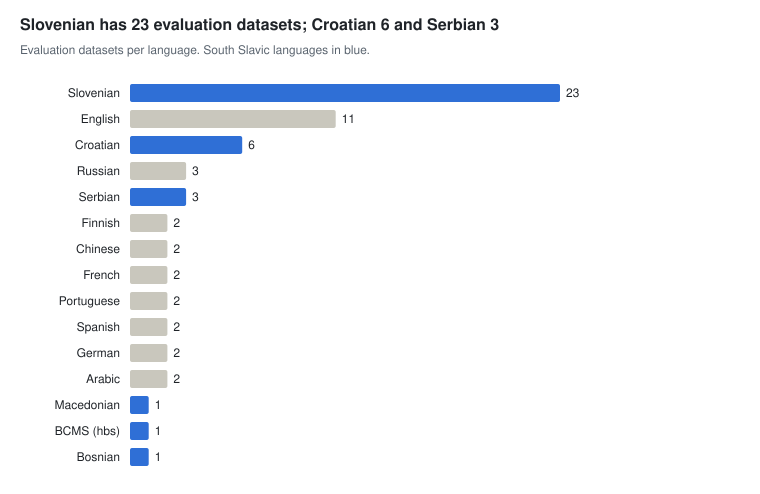

# Evaluation and benchmarks

[← Overview](README.md) · Part of *CLARIN.SI resources for AI development* · Data as of 22 October 2026

Slovenian has a usable LLM evaluation suite: SuperGLUE and SQuAD 2.0 translations, SI-NLI, SloWiC, KE-WSC, a bias set (EEC-SL) and, since 2026, legal NLI, pragmatics and ethics sets. Other South Slavic languages have only COPA (Croatian, Serbian, Macedonian and dialects). The SloBENCH framework, listed under models and tools, hosts leaderboards for several of these sets.

A multilingual dataset counts once for each of its languages.

**Sections:** [LLM benchmarks](#llm-benchmarks) · [Task and lexical test sets](#task-and-lexical-test-sets)

## LLM benchmarks

WALS-Bench and GramQA (2026) are multilingual and test metalinguistic and grammatical knowledge across many languages.

#### Slovenian, including multilingual resources with Slovenian

| Resource | Languages | Size | Licence | Year |
| --- | --- | --- | --- | --- |
| [Slovenian Word in Context dataset SloWiC 1.0](http://hdl.handle.net/11356/1781) | sl | 15k items | CC BY-SA | 2023 |
| [Slovenian Equity Evaluation Corpus EEC-SL 1.0](http://hdl.handle.net/11356/2049) | sl | 8.6k sentences | CC BY | 2025 |
| [Slovene Natural Language Inference Dataset SI-NLI](http://hdl.handle.net/11356/1707) | sl | 5.9k units | CC BY-NC-SA | 2022 |
| [AI-generated text corpus AI-GenT 1.0](http://hdl.handle.net/11356/2210) | en, sl | 3.3k texts | CC BY-NC-SA | 2026 |
| [Slovenian legal natural language inference dataset SLawNLI](http://hdl.handle.net/11356/2100) | sl | 2.2k units | CC BY | 2026 |
| [Choice of plausible alternatives datasets in South Slavic dialects DIALECT-COPA](http://hdl.handle.net/11356/1766) | sl, hr, sr, ckm | 1.5k items | CC BY-SA | 2024 |
| [Knowledge-Enhanced Winograd Schema Challenge KE-WSC 1.0](http://hdl.handle.net/11356/1988) | sl, en | 1k entries | CC BY | 2024 |
| [English-Slovene sample of the ETHICS dataset ETHICS-EN-SL 1.0](http://hdl.handle.net/11356/2337) | en, sl | 500 entries | MIT | 2026 |
| [Pragmatics understanding benchmark for Czech, Slovenian and Croatian PragMega CzeSloCro](http://hdl.handle.net/11356/2261) | sl, hr, cs, en | 420 items | CC BY-SA | 2026 |
| [Slovene translation of SuperGLUE](http://hdl.handle.net/11356/1380) | sl | – | CC BY | 2020 |
| [Extensions to the Slovene translation of SuperGLUE](http://hdl.handle.net/11356/1704) | sl | – | CC BY | 2022 |
| [Slovene translation of the SQuAD2.0 dataset](http://hdl.handle.net/11356/1756) | sl | – | CC BY | 2022 |

#### Other languages

| Resource | Languages | Size | Licence | Year |
| --- | --- | --- | --- | --- |
| [Choice of plausible alternatives dataset in Croatian COPA-HR](http://hdl.handle.net/11356/1404) | hr | 1k items | CC BY-SA | 2021 |
| [Choice of plausible alternatives dataset in Macedonian COPA-MK](http://hdl.handle.net/11356/1687) | mk | 1k items | CC BY-SA | 2022 |
| [Choice of plausible alternatives dataset in Serbian COPA-SR](http://hdl.handle.net/11356/1708) | sr | 1k items | CC BY-SA | 2022 |
| [A multilingual benchmark for evaluating metalinguistic knowledge WALS-Bench 1.0](http://hdl.handle.net/11356/2083) | en, mul | 76.7k entries | CC BY | 2026 |
| [Corpus-grounded evaluation dataset for grammatical question answering GramQA 1.0](http://hdl.handle.net/11356/2086) | mul | 1.9k entries | CC BY | 2026 |
| [English translation of the Slovene Natural Language Inference Dataset SI-NLI-en 1.0](http://hdl.handle.net/11356/1934) | en | 5.9k units | CC BY-NC-SA | 2024 |

## Task and lexical test sets

SYNDIST and COLLDIST (2025) test LLM lexical knowledge with distractors; Šolar-Eval and DASSLE target grammatical error correction.

| Resource | Languages | Size | Licence | Year |
| --- | --- | --- | --- | --- |
| [Multilingual Culture-Independent Word Analogy Datasets](http://hdl.handle.net/11356/1261) | 9 languages | 1.4M entries | CC BY-SA | 2019 |
| [Dataset for evaluation of Slovene spell- and grammar-checking tools Šolar-Eval 1.0](http://hdl.handle.net/11356/1902) | sl | 69.7k words | CC BY-NC-SA | 2023 |
| [Dataset of annotated collocation-distractor pairs COLLDIST](http://hdl.handle.net/11356/2076) | sl | 59.6k entries | CC BY | 2025 |
| [Dataset of annotated headword-synonym-distractor triplets SYNDIST](http://hdl.handle.net/11356/2056) | sl | 51k entries | CC BY | 2025 |
| [The news articles reporting on the 2021 Tokyo Olympics data set OG2021 (research)](http://hdl.handle.net/11356/1921) | 9 languages | 10.9k articles | ACA (BY-NC) | 2024 |
| [The news articles reporting on the 2021 Tokyo Olympics data set OG2021 (public)](http://hdl.handle.net/11356/1922) | 9 languages | 10.9k articles | CC BY-NC-ND | 2024 |
| [Dataset of Authentic and Synthetic Slovene Language Errors DASSLE 1.0](http://hdl.handle.net/11356/2052) | sl | 7.4k entries | CC BY-NC-SA | 2025 |
| [Slovenian Definition Extraction evaluation datasets RSDO-def 1.0](http://hdl.handle.net/11356/1841) | sl | 2.2k sentences | CC BY-SA | 2023 |
| [SimLex-999 Slovenian translation SimLex-999-sl 1.0](http://hdl.handle.net/11356/1309) | sl, en | 999 entries | CC BY | 2020 |
| [A Resource for Evaluating Graded Word Similarity in Context: CoSimLex](http://hdl.handle.net/11356/1308) | en, hr, fi, sl | 580 entries | GPL-3.0 | 2020 |
| [Semantic change detection datasets for Slovenian 1.0](http://hdl.handle.net/11356/1651) | sl | – | MIT | 2022 |
| [Document-level aspect-based sentiment analysis dataset AspectBench (HBS Subset) 1.0](http://hdl.handle.net/11356/2356) | hbs, bs, sr, hr | 20.5M words | ACA (BY) | 2026 |

---

Other stages: [Pre-training data](01-pretraining.md) · [Speech and multimodal data](02-speech-multimodal.md) · [Post-training data](03-post-training.md) · [Evaluation and benchmarks](04-evaluation.md) · [Lexical and knowledge resources](05-lexical-knowledge.md) · [Models and tools](06-models-tools.md)
