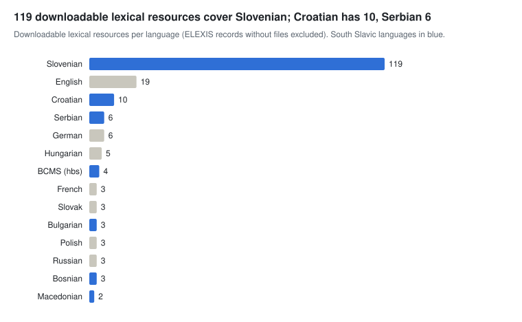

# Lexical and knowledge resources

[← Overview](./) · Part of *CLARIN.SI resources for AI development* · Data as of 22 October 2026

Slovenian is unusually well covered by open, machine-readable lexical data: a 372k-lemma morphological lexicon (Sloleks 3.1), two wordnets, a 102k-entry thesaurus and a 78k-entry collocation dictionary, all under CC BY-SA or more permissive licences. For AI work these resources seed instruction and QA data (as in SloLexQA), support lexical probes and benchmarks (as in SYNDIST and COLLDIST), ground generation through retrieval, and help evaluate tokenisers and morphology.

A multilingual resource counts once for each of its languages.

**Sections:** [Dictionaries and lexical databases](#dictionaries-and-lexical-databases) · [Morphological and phonological lexicons](#morphological-and-phonological-lexicons) · [Semantic, collocation and sentiment lexicons](#semantic-collocation-and-sentiment-lexicons) · [Terminology](#terminology) · [Frequency lists and n-grams](#frequency-lists-and-n-grams) · [ELEXIS dictionaries](#elexis-dictionaries)

## Dictionaries and lexical databases

| Resource | Languages | Size | Licence | Year |
| --- | --- | --- | --- | --- |
| [List of Slovenian headwords 1.1](http://hdl.handle.net/11356/1038) | sl | 354.2k entries | CC BY-NC | 2006 |
| [Dictionary of Lesser Used Slovenian Words](http://hdl.handle.net/11356/1130) | sl | 178.5k entries | CC BY | 2017 |
| [Reverse dictionary of Slovenian language](http://hdl.handle.net/11356/1094) | sl | 115.4k entries | CC BY | 1996 |
| [Slovenian-German Dictionary of Maks Pleteršnik (1894-1895)](http://hdl.handle.net/11356/1114) | sl, de | 103.2k entries | CC BY | 2006 |
| [Franček portal headword list](http://hdl.handle.net/11356/1445) | sl | 100k entries | CC BY | 2021 |
| [Dictionary of the Slovenian Normative Guide (2001)](http://hdl.handle.net/11356/1136) | sl | 92.6k entries | CC BY-NC-ND | 2019 |
| [Franček portal historical module](http://hdl.handle.net/11356/1472) | sl | 41.9k entries | CC BY | 2021 |
| [Lexicon of historical Slovene imp25k 1.1](http://hdl.handle.net/11356/1032) | sl | 28k entries | CC BY | 2014 |
| [Words of the 16th-Century Slovenian Literary Language](http://hdl.handle.net/11356/1127) | sl | 27.8k entries | CC BY | 2011 |
| [Comprehensive Slovenian-Hungarian Dictionary 3.0](http://hdl.handle.net/11356/2091) | sl, hu | 19k entries | CC BY-SA | 2026 |
| [List of Slovenian pseudowords](http://hdl.handle.net/11356/2200) | sl | 17.2k entries | CC BY | 2026 |
| [Slovene-Japanese Learner's Dictionary sloJa 1.1](http://hdl.handle.net/11356/2071) | sl, ja | 10k items | CC BY | 2025 |
| [Japanese-Slovene learner's dictionary jaSlo 3.1](http://hdl.handle.net/11356/1050) | ja, sl | 9.9k entries | CC BY-SA | 2016 |
| [Dictionary of the Slovenian Language in the Works of Janez Svetokriški](http://hdl.handle.net/11356/1092) | sl | 8.5k entries | CC BY | 2006 |
| [Dictionary of New Slovenian Words](http://hdl.handle.net/11356/1091) | sl | 6.4k entries | CC BY | 2012 |
| [Dictionary of living Slovenian "Razvezani Jezik" (The Unleashed Tongue)](http://hdl.handle.net/11356/1385) | sl | 5.8k entries | CC BY | 2020 |
| [Core vocabulary for Slovenian as L2 1.0](http://hdl.handle.net/11356/1697) | sl | 5.3k entries | ACA (BY-NC) | 2022 |
| [Reference List of Slovene Frequent Common Words](http://hdl.handle.net/11356/1346) | sl | 4.8k entries | CC BY | 2020 |
| [List of potentially non-standard vocabulary candidates MEZZANINE-NstdLex 1.1](http://hdl.handle.net/11356/2357) | sl | 4.3k words | CC BY-SA | 2026 |
| [Dictionary of Slovenian Phrasemes](http://hdl.handle.net/11356/1129) | sl | 3k entries | CC BY-NC | 2011 |
| [The "Arcticae horulae" dictionary of German borrowings in Slovenian](http://hdl.handle.net/11356/1379) | sl, de | 2.1k entries | CC BY | 2020 |
| [Dictionary of Twitterese Janes-Dict 1.0](http://hdl.handle.net/11356/1172) | sl | 1k entries | CC BY-SA | 2018 |
| [A1 core vocabulary with lexical information for Slovenian 1.0](http://hdl.handle.net/11356/1896) | sl, en, hu, sq | 991 entries | CC BY-NC-SA | 2023 |
| [Dictionary of Slovenian phrasemes: school edition](http://hdl.handle.net/11356/1459) | sl | 985 entries | CC BY | 2021 |
| [Franček portal dialect module](http://hdl.handle.net/11356/1473) | sl | 834 entries | CC BY | 2021 |
| [Dictionary of Slovenian Particles](http://hdl.handle.net/11356/1128) | sl | 429 entries | CC BY | 2015 |
| [List of single-word male and female occupations in Slovenian](http://hdl.handle.net/11356/1347) | sl | 234 entries | CC BY | 2020 |
| [eSSKJ: Dictionary of the Slovenian Standard Language 2016](http://hdl.handle.net/11356/1249) | sl | 90 entries | CC BY-NC-ND | 2016 |
| [eSSKJ: Dictionary of the Slovenian standard language (phraseological database): school edition](http://hdl.handle.net/11356/1458) | sl | 84 entries | CC BY | 2021 |
| [Slovene Grammars and Orthographic Dictionaries](http://hdl.handle.net/11356/1122) | sl | 51 entries | CC BY | 2015 |
| [Growing Dictionary of the Slovenian Language](http://hdl.handle.net/11356/1248) | sl | – | CC BY-NC-ND | 2014 |
| [School dictionary of Slovenian language (human audio recordings)](http://hdl.handle.net/11356/1460) | sl | 2.1k files | CC BY | 2021 |
| [Genus (proximum) in the SSKJ2 dictionary senses](http://hdl.handle.net/11356/2254) | sl | – | CC BY | 2026 |
| [The Croatian web dictionary Mrežnik (A-F) 1.0](http://hdl.handle.net/11356/1475) | hr | 1.6k entries | CC BY-NC-ND | 2021 |
| [List of headword candidates for the Dutch-Slovene Dictionary nl-sl-Lex 1.0](http://hdl.handle.net/11356/2220) | nl | 60.8k entries | CC BY-SA | 2026 |

## Morphological and phonological lexicons

#### Slovenian, including multilingual resources with Slovenian

| Resource | Languages | Size | Licence | Year |
| --- | --- | --- | --- | --- |
| [MULTEXT-East free lexicons  4.0](http://hdl.handle.net/11356/1041) | 10 languages | 3.7M entries | CC BY-SA | 2010 |
| [Beseda Corpus Lemmatisation Lexicon](http://hdl.handle.net/11356/1141) | sl | 3.2M entries | CC BY | 2017 |
| [Automatically stress labelled morphological lexicon Sloleks 1.2,  version 1.1](http://hdl.handle.net/11356/1186) | sl | 2.8M words | CC BY-NC-SA | 2018 |
| [Morphological Lexicon of Slovene Sloleks 3.1](http://hdl.handle.net/11356/2080) | sl | 372.3k entries | CC BY-SA | 2026 |
| [Dataset of Annotated Slovene Words with Pre-Consonant L ILS 1.0](http://hdl.handle.net/11356/2025) | sl | 173.4k words | CC BY-SA | 2024 |
| [Morphological lexicon Franček](http://hdl.handle.net/11356/1477) | sl | 96.4k entries | CC BY | 2022 |
| [Morphological patterns from the Sloleks 2.0 lexicon 1.0](http://hdl.handle.net/11356/1411) | sl | 96.3k units | CC BY-SA | 2020 |
| [List of word relations from the Sloleks 2.0 lexicon 1.1](http://hdl.handle.net/11356/1986) | sl | 66.3k entries | CC BY-SA | 2024 |
| [Lists of Slovene accentuated units SNES 1.0](http://hdl.handle.net/11356/2003) | sl | 24.2k entries | CC BY-SA | 2024 |
| [Dataset of Slovene word formation trees ArboSloleks 1.0](http://hdl.handle.net/11356/2000) | sl | 14.9k items | CC BY-SA | 2024 |
| [Database of the Western South Slavic Verb HyperVerb 2.0 -- WeSoSlav](http://hdl.handle.net/11356/1846) | 5 languages | 8.3k entries | CC BY | 2024 |
| [Slovene morphological segmentation and word formation dataset KOBOS](http://hdl.handle.net/11356/2060) | sl | 1.9k entries | CC BY | 2026 |
| [Database of the Western South Slavic Verb HyperVerb -- Derivation](http://hdl.handle.net/11356/1855) | 5 languages | – | CC BY-SA | 2023 |
| [Overview of inflectional paradigms in Slovenian](http://hdl.handle.net/11356/1941) | sl | – | CC BY | 2024 |

#### Other languages

| Resource | Languages | Size | Licence | Year |
| --- | --- | --- | --- | --- |
| [Inflectional lexicon srLex 1.3](http://hdl.handle.net/11356/1233) | sr | 169.3k entries | CC BY-SA | 2019 |
| [Inflectional lexicon hrLex 1.3](http://hdl.handle.net/11356/1232) | hr | 164.2k entries | CC BY-SA | 2019 |
| [MULTEXT-East non-commercial lexicons 4.0](http://hdl.handle.net/11356/1042) | 5 languages | 2.3M entries | MULTEXT-East (NC) | 2010 |

## Semantic, collocation and sentiment lexicons

#### Slovenian, including multilingual resources with Slovenian

| Resource | Languages | Size | Licence | Year |
| --- | --- | --- | --- | --- |
| [Concreteness and imageability lexicon MEGA.HR-Crossling](http://hdl.handle.net/11356/1187) | 77 languages | 7.2M entries | CC BY-SA | 2018 |
| [List of Linked Senses from Open Slovene WordNet and the Digital Dictionary Database of Slovene 1.0](http://hdl.handle.net/11356/1897) | sl | 164.9k units | CC BY | 2023 |
| [Thesaurus of Modern Slovene 2.2](http://hdl.handle.net/11356/2092) | sl | 102.1k entries | CC BY-SA | 2026 |
| [Open Slovene WordNet OSWN 1.0](http://hdl.handle.net/11356/1888) | sl, en | 95.3k synsets | CC BY-SA | 2023 |
| [Slovene sentiment lexicon KSS 1.1](http://hdl.handle.net/11356/1097) | sl | 90.6k words | CC BY | 2017 |
| [Slovenian datasets for contextual synonym and antonym detection](http://hdl.handle.net/11356/1694) | sl | 79.2k entries | CC BY-SA | 2022 |
| [Collocations Dictionary of Modern Slovene KSSS 2.2](http://hdl.handle.net/11356/2090) | sl | 78k entries | CC BY-SA | 2026 |
| [Automatically constructed multiword lexicon slMWELex v0.5](http://hdl.handle.net/11356/1179) | sl | 47.6k entries | CC BY | 2015 |
| [Semantic lexicon of Slovene sloWNet 3.1](http://hdl.handle.net/11356/1026) | sl, en | 43.5k synsets | CC BY-SA | 2015 |
| [Slovenian Semantic Lexicon sloWNet-USAS 1.0](http://hdl.handle.net/11356/1925) | sl | 41.1k entries | CC BY-SA | 2024 |
| [Word association norms for Slovenian SWOW-SL 1.0](http://hdl.handle.net/11356/1980) | sl | 19.9k entries | CC BY-NC-ND | 2024 |
| [Slovene sentiment lexicon JOB 1.0](http://hdl.handle.net/11356/1112) | sl | 25.5k entries | CC BY-SA | 2017 |
| [Slovenian Emotion Dimension and Emotion Association Lexicon SloEmoLex 1.0](http://hdl.handle.net/11356/1875) | sl | 20k entries | CC BY-NC-SA | 2024 |
| [Valency lexicon extracted from the Gigafida 2.1 corpus](http://hdl.handle.net/11356/1418) | sl | 14.6k entries | CC BY-SA | 2021 |
| [The LiLaH Emotion Lexicon of Croatian, Dutch and Slovene](http://hdl.handle.net/11356/1318) | hr, nl, sl | 14.2k entries | CC BY-NC-SA | 2020 |
| [Multiword Expressions lexicon extracted from the Gigafida 2.1 corpus](http://hdl.handle.net/11356/1421) | sl | 5.2k entries | CC BY-SA | 2021 |
| [Slovene lexical database 1.0](http://hdl.handle.net/11356/1030) | sl | 2.5k entries | CC BY-NC-SA | 2013 |
| [School dictionary of Slovenian language (semantic database)](http://hdl.handle.net/11356/1451) | sl | 2k entries | CC BY | 2021 |
| [eSSKJ collocations 1.0](http://hdl.handle.net/11356/1883) | sl | 2k entries | CC BY-SA | 2023 |
| [eSSKJ: Dictionary of the Slovenian standard language (semantic database): school edition](http://hdl.handle.net/11356/1456) | sl | 1.6k entries | CC BY | 2021 |
| [Slovenian Word Associations with Explanations WAX-sl](http://hdl.handle.net/11356/2358) | sl | 1.3k items | CC BY-SA | 2026 |
| [Ontology of topics for Slovenian as a second and foreign language ONTEM 1.0](http://hdl.handle.net/11356/2069) | sl, en | 1k entries | CC BY-NC-SA | 2025 |
| [Emoji Sentiment Ranking 1.0](http://hdl.handle.net/11356/1048) | 13 languages | 751 entries | CC BY-SA | 2015 |
| [Collocation lexicon of Slovene academic discourse Aleks](http://hdl.handle.net/11356/1245) | sl | 463 entries | CC BY | 2019 |
| [Slovene ontology of semantic types for nouns SLONEST-noun 1.0](http://hdl.handle.net/11356/1428) | sl | 271 entries | CC BY-SA | 2020 |
| [Annotated collocation candidates for three common syntactic structures in Slovene](http://hdl.handle.net/11356/1903) | sl | – | CC BY-SA | 2023 |

#### Other languages

| Resource | Languages | Size | Licence | Year |
| --- | --- | --- | --- | --- |
| [Automatically constructed multiword lexicon hrMWELex v0.5](http://hdl.handle.net/11356/1177) | hr | 43.7k entries | CC BY | 2015 |
| [Automatically constructed multiword lexicon srMWELex v0.5](http://hdl.handle.net/11356/1178) | sr | 22.3k entries | CC BY | 2015 |
| [Croatian SenseGraph 1.0](http://hdl.handle.net/11356/1218) | hr | 649 words | CC BY-SA | 2018 |

## Terminology

| Resource | Languages | Size | Licence | Year |
| --- | --- | --- | --- | --- |
| [English-Slovene term candidates KAS-biterm 1.0](http://hdl.handle.net/11356/1263) | sl, en | 133.7k entries | CC BY | 2020 |
| [Terminological multiword expressions lexicon](http://hdl.handle.net/11356/1780) | sl | 42.9k entries | CC BY-SA | 2023 |
| [Terminology identification dataset KAS-term 1.0](http://hdl.handle.net/11356/1198) | sl | 22.9k entries | CC BY-SA | 2018 |
| [Geographical Terminological Dictionary](http://hdl.handle.net/11356/1247) | sl | 8.9k entries | CC BY-NC-ND | 2019 |
| [Terminological dictionary of papermaking](http://hdl.handle.net/11356/2074) | sl, en, de, fr | 4.4k entries | CC BY | 2025 |
| [TermFrame: Terms, definitions and semantic annotations for karstology](http://hdl.handle.net/11356/1463) | en, sl, hr | 2.3k entries | CC BY | 2021 |
| [Lexical database of Slovene PR terminology TERMIS](http://hdl.handle.net/11356/1196) | sl | 2k entries | CC BY | 2017 |
| [Slovenian-English glossary of education](http://hdl.handle.net/11356/1731) | sl, en | 1k terms | CC BY | 2022 |
| [Slovenian Social Assistance Rights Terminology SSAR-TERM 1.0](http://hdl.handle.net/11356/2258) | sl | 983 terms | CC BY-SA | 2026 |
| [Terminological dictionary of tax terminology](http://hdl.handle.net/11356/1721) | sl, hr, en | 972 entries | CC BY | 2022 |
| [The Dictionary of the Clothing Terminology of the Zilja Dialect in Canale Valley (Kanalska dolina – Val Canale – Kanaltal – Valcjanâl)](http://hdl.handle.net/11356/1217) | sl | 594 entries | CC BY | 2019 |
| [Terminological dictionary of artificial intelligence](http://hdl.handle.net/11356/1727) | sl, en | 413 terms | CC BY | 2022 |
| [Glossary for academic integrity](http://hdl.handle.net/11356/1728) | sl, en, de | 212 terms | CC BY | 2022 |
| [Military dictionary by students of defence studies](http://hdl.handle.net/11356/1726) | sl, en | 192 items | CC BY | 2014 |
| [English-Slovenian chess terminology database 1.0](http://hdl.handle.net/11356/1680) | en, sl | 77 entries | CC BY-SA | 2022 |
| [Terminological dictionary of electronic smoking](http://hdl.handle.net/11356/1723) | sl, en | 91 terms | CC BY | 2019 |
| [Glossary of equestrianism](http://hdl.handle.net/11356/1725) | sl, en | 57 terms | CC BY | 2019 |

## Frequency lists and n-grams

These resources are derived from Gigafida, Gos, Trendi, Janes, KRES, Šolar and Učbeniki. For AI work they mainly help with tokeniser design, vocabulary coverage checks and data filtering.

| Resource | Languages | Size | Licence | Year |
| --- | --- | --- | --- | --- |
| [Frequency list of words from the Trendi corpus 2021](http://hdl.handle.net/11356/1712) | sl | 4.9M entries | CC BY-SA | 2022 |
| [Frequency lists of syntactic structures from the Učbeniki 1.0 corpus](http://hdl.handle.net/11356/2010) | sl | 4.8M entries | CC BY-SA | 2025 |
| [Nova Beseda Frequency Lexicon](http://hdl.handle.net/11356/1155) | sl | 2.3M entries | CC BY | 2017 |
| [Frequency list of words by source from the Trendi corpus 2022-07](http://hdl.handle.net/11356/1702) | sl | 2M entries | CC BY-SA | 2022 |
| [Frequency lists of syntactic structures from the Šolar 3.0 corpus](http://hdl.handle.net/11356/2009) | sl | 1.9M entries | CC BY-SA | 2025 |
| [Frequency list of collocations from the Učbeniki 1.0 corpus](http://hdl.handle.net/11356/2012) | sl | 701.9k entries | CC BY-SA | 2025 |
| [Frequency list of collocations from the Šolar 3.0 corpus](http://hdl.handle.net/11356/2011) | sl | 256.3k entries | CC BY-SA | 2025 |
| [Frequency list of language problems from Šolar 3.0](http://hdl.handle.net/11356/1716) | sl | 36.6k entries | CC BY-NC-SA | 2022 |
| [Frequency list of textbook vocabulary by level of education in elementary and secondary schools](http://hdl.handle.net/11356/1719) | sl | 11.9k words | CC BY-NC-SA | 2023 |
| [Keywords and n-grams from a textbook corpus](http://hdl.handle.net/11356/1215) | sl | 6k words | CC BY | 2019 |
| [Gos corpus n-grams 2.0](http://hdl.handle.net/11356/1195) | sl | – | CC BY-SA | 2018 |
| [IMP corpus n-grams 2.0](http://hdl.handle.net/11356/1194) | sl | – | CC BY-SA | 2018 |
| [Janes corpus n-grams 1.0](http://hdl.handle.net/11356/1192) | sl | – | CC BY-SA | 2018 |
| [Kres corpus n-grams 2.0](http://hdl.handle.net/11356/1193) | sl | – | CC BY-SA | 2018 |
| [Frequency lists of character-level n-grams from the GOS 1.0 corpus 1.1](http://hdl.handle.net/11356/1363) | sl | 15 files | CC BY-SA | 2020 |
| [Frequency lists of words from the GOS 1.0 corpus 1.1](http://hdl.handle.net/11356/1364) | sl | – | CC BY-SA | 2020 |
| [Frequency lists of word parts from the GOS 1.0 corpus 1.1](http://hdl.handle.net/11356/1366) | sl | 390 files | CC BY-SA | 2020 |
| [Frequency lists of word-level n-grams from the GOS 1.0 corpus 1.1](http://hdl.handle.net/11356/1365) | sl | 23 files | CC BY-SA | 2020 |
| [Frequency lists of character-level n-grams from the Gigafida 2.0 corpus](http://hdl.handle.net/11356/1272) | sl | – | CC BY-SA | 2019 |
| [Frequency lists of words from the Gigafida 2.0 corpus](http://hdl.handle.net/11356/1273) | sl | – | CC BY-SA | 2019 |
| [Frequency lists of word-level n-grams from the Gigafida 2.0 corpus](http://hdl.handle.net/11356/1274) | sl | – | CC BY-SA | 2019 |
| [Frequency lists of word parts from the Gigafida 2.0 corpus](http://hdl.handle.net/11356/1275) | sl | – | CC BY-SA | 2019 |
| [List of formulaic sequences in spoken Slovenian](http://hdl.handle.net/11356/1279) | sl | – | CC BY-SA | 2020 |
| [List of formulaic sequences in standard written Slovenian](http://hdl.handle.net/11356/1280) | sl | – | CC BY-SA | 2020 |
| [Consonant-vowel structures in the Gigafida 2.0 corpus](http://hdl.handle.net/11356/1289) | sl | – | CC BY-SA | 2020 |
| [Consonant-vowel structures in the GOS 1.0 corpus 1.1](http://hdl.handle.net/11356/1367) | sl | – | CC BY-SA | 2020 |
| [Frequency lists of collocations from the Gigafida 2.1 corpus](http://hdl.handle.net/11356/1415) | sl | 82 files | CC BY-SA | 2021 |
| [Frequency lists of word-level n-grams from the Trendi corpus 2021](http://hdl.handle.net/11356/1713) | sl | 4 files | CC BY-SA | 2022 |
| [Syntactic Tree Inventories from Slovenian UD Corpora (v2.15)](http://hdl.handle.net/11356/2035) | sl | – | CC BY | 2025 |
| [Syntactic Tree Inventories from English GUM UD Corpus (v2.15)](http://hdl.handle.net/11356/2036) | en | – | CC BY | 2025 |

## ELEXIS dictionaries

134 records describe dictionaries contributed to the ELEXIS project in about 40 languages; the most frequent are French (19), German (18), English (18), Slovenian (14), Serbian (11), Danish (9) and Lithuanian (9). None of these records has files or a licence in the repository: the data is hosted elsewhere, and access goes through each provider. The full list is in the spreadsheet.

---

Other stages: [Pre-training data](01-pretraining.md) · [Speech and multimodal data](02-speech-multimodal.md) · [Post-training data](03-post-training.md) · [Evaluation and benchmarks](04-evaluation.md) · [Lexical and knowledge resources](05-lexical-knowledge.md) · [Models and tools](06-models-tools.md)
