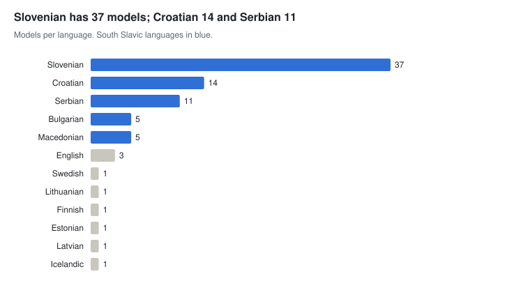

# Models and tools

[← Overview](./) · Part of *CLARIN.SI resources for AI development* · Data as of 22 October 2026

The repository holds encoder models, task models and speech and translation systems, but no generative LLM weights; the GaMS models referenced by the instruction sets are distributed on Hugging Face. These resources are most useful as baselines, as annotators for building training data (CLASSLA-Stanza, SPOT-Trankit), and for evaluation (SloBENCH, ASR model evaluator).

A multilingual model counts once for each of its languages; RSDO web-service records excluded.

**Sections:** [Models](#models) · [Tools](#tools)

## Models

The RSDO speech recognition, translation and punctuation models also have matching NeMo web-service records (3 records, Apache 2.0), listed in the spreadsheet.

#### Slovenian, including multilingual resources with Slovenian

| Resource | Languages | Size | Licence | Year |
| --- | --- | --- | --- | --- |
| [Slovenian RoBERTa contextual embeddings model: SloBERTa 2.0](http://hdl.handle.net/11356/1397) | sl | – | CC BY-SA | 2021 |
| [CroSloEngual BERT 1.1](http://hdl.handle.net/11356/1330) | hr, sl, en | – | CC BY | 2020 |
| [The SPOT-Trankit model for linguistic processing of written and spoken Slovenian 1.3](http://hdl.handle.net/11356/2201) | sl | – | Apache 2.0 | 2026 |
| CLASSLA-Stanza and CLASSLA-StanfordNLP models (39 records: lemmatisation, morphosyntax, UD/JOS parsing, NER, SRL for standard, non-standard and spoken text) | sl, hr, sr, mk, bg | – | CC BY-SA | 2019–2025 |
| [Slovene Conformer CTC BPE E2E Automated Speech Recognition model PROTOVERB-ASR-E2E 1.0](http://hdl.handle.net/11356/2024) | sl | – | Apache 2.0 | 2025 |
| [Slovene Conformer CTC BPE E2E Automated Speech Recognition model RSDO-DS2-ASR-E2E 2.0](http://hdl.handle.net/11356/1737) | sl | – | Apache 2.0 | 2022 |
| [Gail Valley dialect E2E Automatic Speech Recognition model Zila 1.0](http://hdl.handle.net/11356/2484) | sl | – | CC BY-NC-SA | 2026 |
| [Face-domain-specific automatic speech recognition models](http://hdl.handle.net/11356/1749) | sl | – | Apache 2.0 | 2023 |
| [Neural Machine Translation model for Slovene-English language pair RSDO-DS4-NMT 1.2.6](http://hdl.handle.net/11356/1736) | sl, en | – | Apache 2.0 | 2022 |
| [Slovene Punctuation and Capitalisation model RSDO-DS2-P&C 3.6](http://hdl.handle.net/11356/1735) | sl | – | Apache 2.0 | 2022 |
| [Slovene Text Normalizator RSDO-DS2-NORM 1.0](http://hdl.handle.net/11356/1742) | sl | – | Apache 2.0 | 2022 |
| [Slovene Text Denormalizator RSDO-DS2-DENORM 1.0](http://hdl.handle.net/11356/1743) | sl | – | Apache 2.0 | 2022 |
| [Slovenian text summarization models](http://hdl.handle.net/11356/1751) | sl | – | CC BY-SA | 2022 |
| [Fine-tuned models for extractive question answering in the Slovenian language](http://hdl.handle.net/11356/1778) | sl | – | CC BY | 2022 |
| [PyTorch model for Slovenian Named Entity Recognition SloNER 1.0](http://hdl.handle.net/11356/1758) | sl | – | CC BY-SA | 2023 |
| [PyTorch model for Slovenian Coreference Resolution](http://hdl.handle.net/11356/1773) | sl | – | CC BY | 2023 |
| [Slovenian commonsense reasoning model SloMET-ATOMIC 2020](http://hdl.handle.net/11356/1729) | sl | – | Apache 2.0 | 2022 |
| [Text classification model SloBERTa-Trendi-Topics 1.0](http://hdl.handle.net/11356/1709) | sl | – | Apache 2.0 | 2022 |
| [Text classification model fastText-Trendi-Topics 1.0](http://hdl.handle.net/11356/1710) | sl | – | Apache 2.0 | 2022 |
| [Multilingual text genre classification model X-GENRE](http://hdl.handle.net/11356/1961) | 10 languages | – | CC BY-SA | 2024 |
| [Pretrained models for recognising sex education concepts SemSEX 1.0](http://hdl.handle.net/11356/1894) | sl | – | CC BY | 2023 |
| [Character-level part-of-speech tagger of Slovene language](http://hdl.handle.net/11356/1211) | sl | – | GPL-3.0 | 2019 |
| [ELMo embeddings model, Slovenian](http://hdl.handle.net/11356/1257) | sl | 1.4M words | Apache 2.0 | 2019 |
| [ELMo embeddings models for seven languages](http://hdl.handle.net/11356/1277) | 7 languages | 7 files | Apache 2.0 | 2019 |
| [Word embeddings CLARIN.SI-embed.sl 2.0](http://hdl.handle.net/11356/1791) | sl | 3.5M entries | CC BY-SA | 2023 |
| [ccGigafida ARPA language model 1.0](http://hdl.handle.net/11356/1119) | sl | 90.5M words | CC BY | 2017 |

#### Other languages

| Resource | Languages | Size | Licence | Year |
| --- | --- | --- | --- | --- |
| [Word embeddings CLARIN.SI-embed.hr 2.0](http://hdl.handle.net/11356/1790) | hr | 3.4M entries | CC BY-SA | 2023 |
| [Word embeddings CLARIN.SI-embed.bg 1.0](http://hdl.handle.net/11356/1796) | bg | 2.7M entries | CC BY-SA | 2023 |
| [Word embeddings CLARIN.SI-embed.sr 2.0](http://hdl.handle.net/11356/1789) | sr | 2.7M entries | CC BY-SA | 2023 |
| [Word embeddings CLARIN.SI-embed.mk 2.0](http://hdl.handle.net/11356/1788) | mk | – | CC BY-SA | 2023 |

## Tools

| Resource | Languages | Licence | Year |
| --- | --- | --- | --- |
| [ASR model evaluator](http://hdl.handle.net/11356/2047) | sl | Apache 2.0 | 2022 |
| [Service for querying dependency treebanks Drevesnik 1.2](http://hdl.handle.net/11356/2034) | sl | Apache 2.0 | 2025 |
| [Corpus extraction tool LIST 1.3](http://hdl.handle.net/11356/1964) | sl, en | Apache 2.0 | 2024 |
| [CORDEX inflectional lookup data 1.0](http://hdl.handle.net/11356/1854) | sl | CC BY-NC-SA | 2023 |
| [R crawlers for five Slovenian web media 1.0](http://hdl.handle.net/11356/1105) | sl | CC BY-SA | 2017 |
| [ZRCola 2](http://hdl.handle.net/11356/1090) | sl, en, ru | GPL-3.0 | 2016 |
| [SloBENCH evaluation framework](http://hdl.handle.net/11356/1469) | – | Apache 2.0 | 2021 |
| [Q-CAT Corpus Annotation Tool 1.5](http://hdl.handle.net/11356/1844) | – | Apache 2.0 | 2023 |
| [Dependency tree extraction tool STARK 3.1](http://hdl.handle.net/11356/2033) | – | Apache 2.0 | 2024 |
| [The Orange workflow for observing collocation trends ColTrend 1.0](http://hdl.handle.net/11356/1424) | – | Apache 2.0 | 2020 |
| [The Orange workflow for observing collocation clusters ColEmbed 1.0](http://hdl.handle.net/11356/1425) | – | Apache 2.0 | 2020 |
| [Font ZRCalo 1.0](http://hdl.handle.net/11356/1884) | – | CC BY | 2023 |
| [DigiLing e-Learning Hub: e-Courses for Digital Linguistics](http://hdl.handle.net/11356/1243) | en | CC BY | 2019 |
| [UPSKILLS Teaching and Learning Content](http://hdl.handle.net/11356/1865) | en | CC BY | 2023 |

---

Other stages: [Pre-training data](01-pretraining.md) · [Speech and multimodal data](02-speech-multimodal.md) · [Post-training data](03-post-training.md) · [Evaluation and benchmarks](04-evaluation.md) · [Lexical and knowledge resources](05-lexical-knowledge.md) · [Models and tools](06-models-tools.md)
