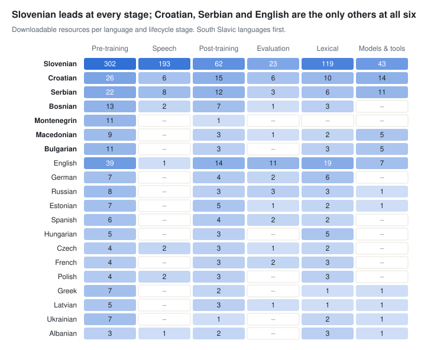

# CLARIN.SI resources for AI development

Data as of 22 October 2026 · Source: CLARIN.SI repository export

The CLARIN.SI repository holds 1,053 current resources that can feed AI development, and 797 of them carry an open licence that also allows commercial training. Its strengths are web text for 16 languages, about 14,500 hours of speech and a fast-growing set of Slovenian instruction and evaluation data. Each lifecycle stage has its own page, linked below; this page gives the overview, the gaps and the method.

**Stage pages:** [Pre-training data](01-pretraining.md) · [Speech and multimodal data](02-speech-multimodal.md) · [Post-training data](03-post-training.md) · [Evaluation and benchmarks](04-evaluation.md) · [Lexical and knowledge resources](05-lexical-knowledge.md) · [Models and tools](06-models-tools.md)

## Lifecycle stages

| Stage | Resources | Open licence | Volume (estimate) | Highlights |
| --- | --- | --- | --- | --- |
| [Pre-training data](01-pretraining.md) | 389 | 330 | ≈ 58B words after removing overlaps (132B across all records) | CLASSLA-web 2.0 (17B words, 7 South Slavic languages, CC0); MaCoCu (7 more languages, CC0); OSS scientific Slovenian (2.6B words) |
| [Speech and multimodal data](02-speech-multimodal.md) | 206 | 190 | ≈ 14,500 hours of speech | ParlaSpeech (Croatian 6,100 h; Czech, Polish, Serbian about 2,000 h each); ARTUR (1,067 h Slovenian); 171 audiobook samples |
| [Post-training data](03-post-training.md) | 84 | 65 | ≈ 2.2M instruction pairs (Slovenian) and 72 supervised task datasets | GaMS-Instruct family, mostly medical; expert Q&A archives; treebanks and NER sets for Slovenian, Croatian and Serbian |
| [Evaluation and benchmarks](04-evaluation.md) | 30 | 22 | 30 datasets covering 21 languages | Slovene SuperGLUE, SI-NLI, SloWiC; COPA for South Slavic languages; 2026 LLM benchmarks (WALS-Bench, GramQA, PragMega) |
| [Lexical and knowledge resources](05-lexical-knowledge.md) | 262 | 110 | ≈ 50M lexicon entries in 128 downloadable resources, plus 134 ELEXIS records without files | Sloleks 3.1 (372k lemmas), sloWNet and OSWN wordnets, Thesaurus of Modern Slovene, KSSS collocations |
| [Models and tools](06-models-tools.md) | 82 | 80 | 68 models and 14 tools; no generative LLM weights | CLASSLA-Stanza pipeline, SloBERTa, CroSloEngual BERT, RSDO speech recognition and translation |

Volumes are rough: many corpora repackage others, so word counts across records overlap. The pre-training estimate drops known repackagings and older crawls; see the method section.

## Language coverage

Counting only resources with downloadable files, Slovenian appears in 742. Croatian (77), Serbian (62), Bosnian (26), Bulgarian (22), Macedonian (20) and Montenegrin (12) follow among the South Slavic languages, and 25 other languages appear in at least five resources (82 languages in total), mostly through multilingual web, parliamentary and lexical collections.

## Key findings

- **Slovenian dominates every stage.** Of all 1,053 resources, 762 include Slovenian: the 742 downloadable ones counted above plus 20 records without files (metaFida, Gigafida, Trendi and 17 ELEXIS dictionaries). A further 128 cover only other South Slavic languages and 163 cover other languages.
- **Licences need checking before use.** 100 resources are non-commercial and 10 are restricted to academic users or have custom terms. 146 records have no licence and no files; they describe resources hosted elsewhere, such as the ELEXIS dictionaries, metaFida, Gigafida and Trendi.
- **2026 is the busiest year so far.** It brought 441 new records: 402 e-book and audiobook samples, new web and monitor corpora, and most of the LLM benchmarks.

## Gaps and recommendations

The repository is strong on pre-training text and linguistic annotation, and weak on the data that modern LLM post-training and evaluation need.

1. **No preference, dialogue or multi-turn data.** All instruction data is single-turn, and 98% of the text instruction pairs are medical or pharmaceutical. Converting the expert Q&A archives (ŠUSS, TermSvet, Terminologišče) and the dictionaries into instruction format is a quick win.
2. **Instruction data exists only for Slovenian.** Croatian, Serbian, Bosnian, Montenegrin, Macedonian and Bulgarian have large open web corpora but no instruction or safety data.
3. **Evaluation for other South Slavic languages stops at COPA.** Extending SI-NLI, PragMega, EEC-SL or SLawNLI to related languages would reuse existing designs.
4. **No Slovenian parliamentary speech corpus.** ParlaSpeech covers Croatian, Serbian, Polish and Czech; siParl (239M words) has transcripts but no aligned audio release.
5. **The largest curated Slovenian corpora cannot be downloaded.** metaFida, Gigafida and Trendi are concordancer-only, and the downloadable subsets are non-commercial. A clear statement on AI training use would help, even where the answer is no.
6. **Metadata does not describe AI readiness.** `dc.subject` uses 725 free keywords, and for about 250 downloadable records the file format cannot be read from the file names. A small controlled field for AI use (pre-training, SFT, evaluation), data format and splits would make this overview easy to keep up to date.

## How to read the stage pages

- **One entry per resource.** All versions of a resource are collapsed into one entry linked to the latest visible version. Hidden records, mostly superseded versions, are left out.
- **Slovenian first.** Long tables are split into Slovenian resources (including multilingual ones with Slovenian) and resources for other languages; rows are sorted by size.
- **Size.** Words where the record gives them, otherwise tokens; speech in hours; other units as recorded.
- **Languages.** ISO 639-1 codes where they exist (sl, hr, sr, bs, mk, bg), otherwise ISO 639-3 (cnr for Montenegrin).
- **Licence.** CC0, CC BY, CC BY-SA, Apache, MIT and GPL allow training and commercial use; CC BY-NC variants and the MULTEXT-East licence are non-commercial; ACA and the CLARIN.SI web-corpus licence are restricted; "none, no files" marks a record that only describes a resource hosted elsewhere.

## Method and full catalogue

The full catalogue is in `clarinsi_ai_catalogue.xlsx`, with one row per resource (including the older versions left out of these pages): stage, subsection, languages, size, licence tier, access, publisher, subjects and description.

1. **Source.** The CLARIN.SI DSpace export `clarinsi.tsv` (1,291 records), read on 14 October 2026.
2. **Version collapsing.** Version numbers are stripped from titles; records with the same remaining title form one family, represented by its latest visible version. Families that are entirely hidden are dropped, as are a few older versions whose titles changed (Sloleks 3.0, KSSS 1.0, Gigafida 2.0, MetaFida 0.1, HyperVerb 1.0) and three web-service records duplicating models.
3. **Classification.** Each resource is assigned to one stage and subsection by rules over `dc.type`, `dc.subject`, the title and the size units, followed by manual overrides for 64 borderline cases.
4. **Volume estimates.** Pre-training text excludes MaCoCu-Genre, the CLASSLA-web 1.0 and older South Slavic web crawls (superseded by CLASSLA-web 2.0), BERTić-data, ParlaMint.ana, ParlaMint-en, Gigafida, Trendi, the cc-subsets and the KAS sub-corpora. Speech hours exclude transcript-only duplicates and ParlaSpeech 3.0, which re-annotates earlier recordings.

Source: [CLARIN.SI repository](https://www.clarin.si/repository/xmlui/).
