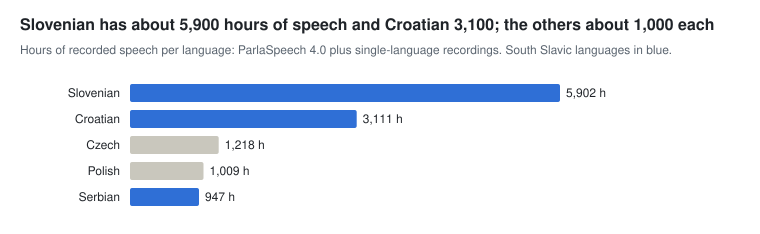

# Slides: Data for AI development at CLARIN.SI

An 80-minute talk (about 70 minutes plus questions) built with [reveal.js](https://revealjs.com/) 5.1. reveal.js is bundled in `reveal/`, so the deck also works offline.

- **Present online:** https://clarinsi.github.io/clarinsi4ai/slides/
- **Present locally:** open `index.html` in a browser. The charts are read from `../img/`, so keep the `slides` folder inside the `clarinsi4ai` folder.
- **PDF copy:** `slides.pdf`

## Presenting

| Key | Action |
| --- | --- |
| → / Space | Next slide |
| ← | Previous slide |
| S | Speaker view with notes, timer and next slide |
| F | Full screen |
| O or Esc | Slide overview |
| B | Black screen |

## Editing

All slides are Markdown inside the `<textarea>` in `index.html`.

- A line containing only `---`, with a blank line before and after it, starts a new slide.
- Lines after `Note:` are speaker notes.
- A `<!-- .slide: data-state="section-slide" data-background-color="#004171" -->` line at the top of a slide makes it a navy section divider.
- Plain HTML works for layouts. Markdown is not parsed inside HTML blocks, so use HTML tags there.

Layout building blocks, defined in `theme.css`:

```html
<div class="cols">…</div>                                  two columns (also: cols w60, cols w40)
<div class="cards" style="--n:3"><div class="card">…</div></div>   card grid with n columns
<div class="stats" style="--n:4"><div class="stat"><div class="num">1,039</div><div class="lbl">resources</div></div></div>
<div class="callout">…</div>                               highlighted note
<span class="tag ok">CC BY</span>  <span class="tag nc">NC</span>  <span class="tag no">ND</span>
<p class="small">…</p>  <p class="tiny">…</p>              smaller text
               chart scaled to the slide
```

Colours and fonts are at the top of `theme.css`.

## Exporting a new PDF

Open `index.html?print-pdf` in Chrome, then print to PDF with layout *Landscape*, margins *None* and *Background graphics* switched on.
